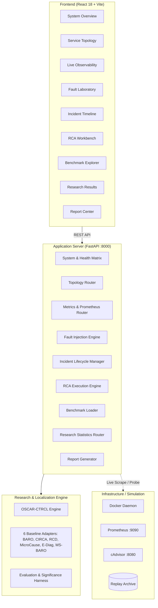

# OSCAR: Observability, Simulation, and Causal Root-Cause Analysis

[](file:///docs/REPRODUCIBILITY_GUIDE.md)
[](file:///frontend)
[](https://github.com/phamquiluan/RCAEval)
[](LICENSE)

> **OSCAR** is an enterprise-grade Root Cause Analysis (RCA) research platform and microservice failure simulator. It features a modern React/TypeScript observability console, an end-to-end fault injection and forensic diagnosis engine, and **OSCAR-CTRCL**, a causal-temporal localization algorithm that mitigates the **Cascading Victim Problem** in microservices.

📖 **Canonical Documentation:** [OSCAR Master Technical & Scientific Document](docs/OSCAR_MASTER_DOCUMENT.md)  
🔍 **Audit & Verification:** [Final Repository Audit Report](docs/FINAL_AUDIT_REPORT.md) | [Reproducibility Guide](docs/REPRODUCIBILITY_GUIDE.md)

---

## 1. The Core Problem: The Cascading Victim Trap

In distributed microservices, a single leaf service suffering from physical resource starvation (such as a database CPU spike or connection pool saturation) causes upstream callers to queue requests, retry failed operations, and consume their own CPU cycles handling timeouts.

```
[Client] ---> [API Gateway] ---> [Order Service] ---> [Payment Service] ---> [PostgreSQL (Fault)]
                 |                      |                     |                    |
             Thread Pool            Connection Pool       Worker Pool         100% CPU Spike
             Saturation              Queue Overflow       Blocked Socket        Unindexed Scan
            (Latency Peak)         (Latency/CPU Jump)     (Timeout Errors)      (ROOT CAUSE)
```

Conventional anomaly detection algorithms mistake the upstream callers (e.g., API Gateway or Order Service) for the root cause because their latency and retry spikes are prominent. **OSCAR-CTRCL** solves this by applying the **Callee Dominance Rule (CDR)** and **Distribution Shift Invariance (DSI)** across physical container metrics.

---

## 2. Key Features

- **Full-Stack Observability Console:** 9 views designed with an enterprise warm-stone light design system (`#fcfbf9` surfaces, slate borders, clean typography).
- **Subsystem Health Matrix:** Transparent real-time monitoring of application server, Docker engine, simulation services, telemetry sources, persistence, and RCA workers.
- **Dual Operational Modes:**
  - *Live Simulation Mode:* Direct container orchestration, live Prometheus/cAdvisor scraping, and container fault injection.
  - *Deterministic Replay Mode:* Seamless historical replay of recorded experiments (`EXP-postgres_cpu_stress_001`) when Docker is offline, ensuring zero UI crashes.
- **Interactive RCA Workbench:** Real-time side-by-side execution of 7 localization algorithms with blind diagnosis and ground-truth reveal controls.
- **Forensic Report Center:** Automated incident report generation in Markdown and PDF formats with complete topological and telemetry provenance.

---

## 3. System Architecture



---

## 4. Verified Research Results (120-Case CPU Cohort)

All results are independently verified from raw case-level evaluations (`research/results/phase2_verified/phase2_detailed_per_case.json`):

| Algorithm | Hit@1 (Top-1) | Hit@3 | MRR | Mean Runtime | Statistical Significance vs RCD |
|---|---|---|---|---|---|
| **OSCAR-CTRCL (Proposed)** | **0.9250 (111/120)** | **0.9500 (114/120)** | **0.9427** | **0.014s** | **$p = 0.0433$ ($b=18, c=7$)** |
| **RCD (Baseline)** | 0.8333 (100/120) | 0.9833 (118/120) | 0.9082 | 0.089s | Reference Baseline |
| **MicroCause (Baseline)** | 0.7750 (93/120) | 0.9167 (110/120) | 0.8499 | 0.042s | $p < 0.001$ |
| **Multi-Source BARO** | 0.7667 (92/120) | 0.9250 (111/120) | 0.8497 | 0.028s | $p < 0.001$ |
| **CIRCA (Baseline)** | 0.7417 (89/120) | 0.9083 (109/120) | 0.8304 | 0.035s | $p < 0.001$ |
| **BARO (Baseline)** | 0.6917 (83/120) | 0.8750 (105/120) | 0.7937 | 0.019s | $p < 0.001$ |
| **E-Diagnosis (Baseline)** | 0.6583 (79/120) | 0.8583 (103/120) | 0.7681 | 0.024s | $p < 0.001$ |

> **Scientific Disclosure:** While OSCAR-CTRCL achieves a statistically significant improvement in top-1 root cause identification (Hit@1: $+9.17\%$, exact McNemar $p = 0.0433 < 0.05$), the rank distribution across all candidates (MRR difference $+0.0345$) yields a Wilcoxon signed-rank $p = 0.5847$. Both OSCAR and RCD are top-tier methods.

---

## 5. Quickstart & Installation

### 5.1 Environment Prerequisites
- Python $\ge 3.10$
- Node.js $\ge 18$
- Docker & Docker Compose (optional, for live mode)

### 5.2 Backend Setup
```bash
# Clone the repository
git clone https://github.com/Loki3306/OSCAR-sim.git
cd OSCAR-sim
git checkout phase3

# Install Python dependencies
pip install -r requirements-research.txt
pip install fastapi uvicorn pydantic requests pytest
```

### 5.3 Frontend Build
```bash
cd frontend
npm install
npm run build
cd ..
```

### 5.4 Launching the Application
```bash
# Start the unified server (serves API and React UI)
python -m uvicorn server.main:app --host 0.0.0.0 --port 8000
```
Open [http://localhost:8000](http://localhost:8000) in your browser.

---

## 6. Running Tests & Reproducing Experiments

```bash
# Execute the full 32-test backend verification suite
python -m pytest tests/ -v

# Recalculate exact statistical significance
python -c "
from research.evaluation.significance import exact_mcnemar_test
res = exact_mcnemar_test(b=18, c=7)
print('Exact McNemar p-value:', res['p_value'])
"
```

---

## 7. Documentation Index

- [docs/OSCAR_MASTER_DOCUMENT.md](docs/OSCAR_MASTER_DOCUMENT.md): Canonical 20-section master technical and research specification.
- [docs/FINAL_AUDIT_REPORT.md](docs/FINAL_AUDIT_REPORT.md): Audit report verifying all 12 prior claims, subsystem matrices, and statistical proofs.
- [docs/REPRODUCIBILITY_GUIDE.md](docs/REPRODUCIBILITY_GUIDE.md): Complete setup and reproduction guide for researchers.
- [docs/ALGORITHM_CATALOG.md](docs/ALGORITHM_CATALOG.md): In-depth algorithmic breakdown of all 7 evaluated models.
- [docs/STATISTICAL_METHODS.md](docs/STATISTICAL_METHODS.md): Mathematical formulations for Hit@K, MRR, exact McNemar tests, and bootstrapping.
- [docs/EXPERIMENT_INDEX.md](docs/EXPERIMENT_INDEX.md): Manifest and provenance index for all benchmark experiments.
- [docs/USER_GUIDE.md](docs/USER_GUIDE.md): End-user operational manual for all 9 application views.
- [docs/DEMO_SCRIPT.md](docs/DEMO_SCRIPT.md): Step-by-step demonstration script for advisor and viva presentations.
- [docs/KNOWN_LIMITATIONS.md](docs/KNOWN_LIMITATIONS.md): Transparent boundaries and engineering constraints.

---

## 8. Attribution & Licensing

- **License:** MIT License for platform code; CC BY 4.0 for research data and documentation.
- **Benchmark:** Incorporates and evaluates data from the [RCAEval](https://github.com/phamquiluan/RCAEval) benchmark (Pham et al., 2024).
