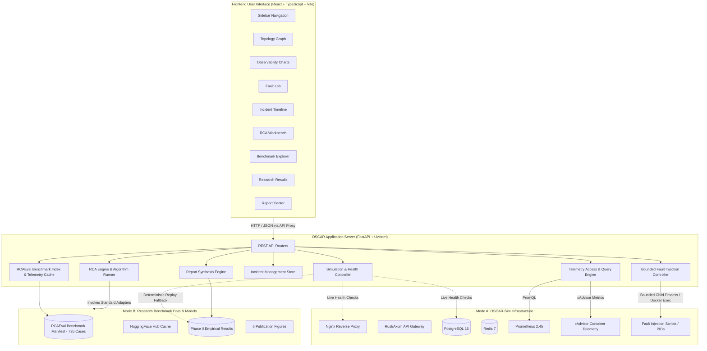

# OSCAR Architecture & System Design

This document details the architectural boundaries, component responsibilities, data flows, and runtime topology of the OSCAR platform.

---

## 1. System Architecture Overview

---

## 2. Component Boundaries & Responsibilities

| Subsystem | Location | Primary Responsibilities |
| :--- | :--- | :--- |
| **Frontend UI** | `frontend/` | React 19 + TypeScript SPA providing dark-mode SRE console views, interactive SVG topology graph, time-series charts, fault controls, and benchmark explorer. |
| **Application API** | `server/api/` | 8 dedicated FastAPI routers: `/api/system`, `/api/metrics`, `/api/faults`, `/api/incidents`, `/api/rca`, `/api/benchmark`, `/api/research`, `/api/reports`. |
| **Simulation Controller** | `server/services/sim_service.py` | Detects Docker daemon availability; coordinates live container health checks or falls back to deterministic telemetry replay from `experiments/metadata/`. |
| **Fault Controller** | `server/services/sim_service.py` | Enforces parameter validation, bounded execution timeouts (max 300s), active PID tracking, and emergency rollback stops. |
| **RCA Orchestrator** | `server/services/rca_service.py` | Standardizes telemetry into normalized `IncidentData` dataclasses and executes baseline adapters (`OSCAR_CTRCL`, `RCD`, `BARO`, `CIRCA`, `MicroCause`, `Epsilon_Diagnosis`, `MultiSource_BARO`). |
| **Benchmark Access** | `server/services/benchmark_service.py` | Loads official RCAEval case manifest (`research/data_manifests/cases.parquet`), performs on-demand telemetry downsampling, and enforces ground-truth separation. |
| **Report Center** | `server/api/reports.py` | Synthesizes Markdown and HTML incident autopsies and statistical comparison tables with export controls. |

---

## 3. Data Flow & Security Model

1. **Privilege Boundary:** The browser interface never executes arbitrary shell commands or directly accesses Docker sockets. All privileged actions (fault injection, service restarts) pass through backend validation controllers with strict parameter bounds.
2. **Ground-Truth Sequestration:** During blind RCA diagnosis, candidate models receive only telemetry data and topology structures. Ground-truth root cause labels are withheld by the API until the client explicitly requests evaluation.
3. **Resilience & Graceful Degradation:** When Docker Desktop is stopped or Prometheus is unreachable, the platform automatically transitions to `REPLAY_DEMO` mode, serving verified telemetry records from previous runs without throwing unhandled exceptions.
