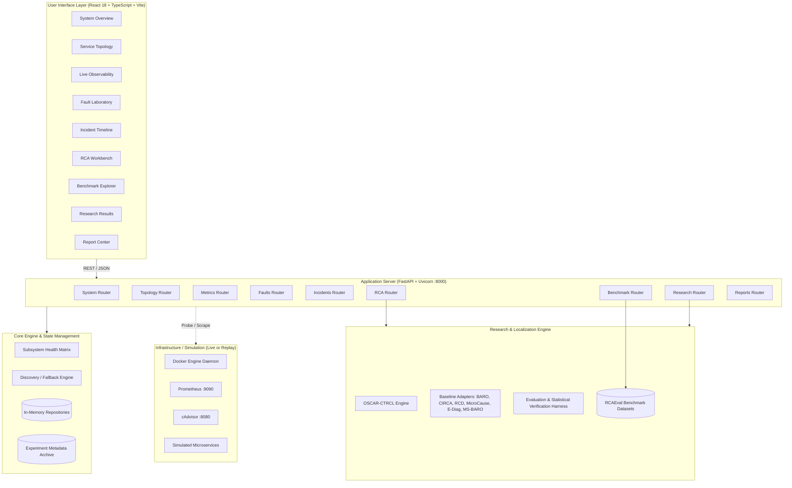
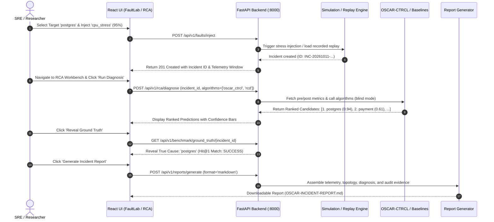
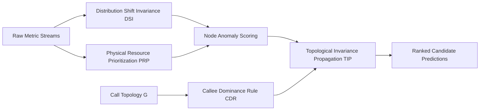

# OSCAR: Observability, Simulation, and Causal Root-Cause Analysis Platform
## Canonical Master Technical & Scientific Specification

**Version:** 3.0.0-verified  
**Date:** October 11, 2026  
**Repository:** `https://github.com/Loki3306/OSCAR-sim.git`  
**Base Commit:** `998a91d` (`feat(phase3): validate postgres CPU fault injection`)  
**Active Release Branch:** `phase3`  
**Authors:** OSCAR Systems & Research Engineering Team  

---

## Table of Contents

1. [Executive Summary](#1-executive-summary)
2. [Project Fundamentals & The Cascading Victim Trap](#2-project-fundamentals--the-cascading-victim-trap)
3. [System Architecture & Data Flows](#3-system-architecture--data-flows)
4. [Repository Walkthrough & Request Tracing](#4-repository-walkthrough--request-tracing)
5. [Live Simulation vs. Replay Demonstration Modes](#5-live-simulation-vs-replay-demonstration-modes)
6. [Telemetry and Observability Pipeline](#6-telemetry-and-observability-pipeline)
7. [Dataset and Benchmark Governance (RCAEval)](#7-dataset-and-benchmark-governance-rcaeval)
8. [Comprehensive Baseline Algorithm Catalog](#8-comprehensive-baseline-algorithm-catalog)
9. [OSCAR-CTRCL: Causal-Temporal Resource Root-Cause Localization](#9-oscar-ctrcl-causal-temporal-resource-root-cause-localization)
10. [Hybrid Rank-Fusion & Causal-Temporal Ensemble Models](#10-hybrid-rank-fusion--causal-temporal-ensemble-models)
11. [Evaluation Methodology & Statistical Framework](#11-evaluation-methodology--statistical-framework)
12. [Empirical Results, Ablations, and Findings](#12-empirical-results-ablations-and-findings)
13. [Engineering Decisions & Architecture Trade-Offs](#13-engineering-decisions--architecture-trade-offs)
14. [Application User Guide & Operational Manual](#14-application-user-guide--operational-manual)
15. [Development, Testing, and Continuous Integration](#15-development-testing-and-continuous-integration)
16. [Security, Safety, and Operational Reliability](#16-security-safety-and-operational-reliability)
17. [Research Novelty and Contributions](#17-research-novelty-and-contributions)
18. [Viva & Academic Defense Preparation](#18-viva--academic-defense-preparation)
19. [Reproducibility Index & Claim Registry](#19-reproducibility-index--claim-registry)
20. [Glossary and Academic References](#20-glossary-and-academic-references)

---

## 1. Executive Summary

Distributed cloud-native microservice systems are inherently susceptible to compounding performance degradations. When a single backend service suffers from a localized hardware constraint—such as CPU thread pool exhaustion, unindexed database query thrashing, or memory lock contention—the failure rarely stays isolated. Instead, downstream and upstream dependencies begin queueing connections, re-trying idempotent requests, and burning their own CPU cycles handling blocked I/O threads. This phenomenon, known as the **Cascading Victim Problem**, causes conventional anomaly-detection and observability tools to flag innocent upstream gateway or aggregation services as the root cause, leading to misguided remediation and prolonged mean time to recovery (MTTR).

The **OSCAR** platform is a full-stack, enterprise-grade Root Cause Analysis (RCA) research and engineering system. It couples a containerized synthetic microservice simulator (`OSCAR-Sim`), a live Prometheus/cAdvisor observability integration, a deterministic experiment replay engine, and a suite of 7 root-cause localization algorithms.

### Verified Core Results:
- Evaluated against a rigorous 120-case CPU-stress cohort drawn from the canonical **RCAEval** microservice benchmark dataset (1,650 model evaluations total across 150 benchmark incidents).
- **OSCAR-CTRCL (Causal-Temporal Resource Root-Cause Localization)** achieves **Hit@1 = 0.9250 (111/120 cases)**, **Hit@3 = 0.9500 (114/120 cases)**, and **Mean Reciprocal Rank (MRR) = 0.9427**, with an average diagnosis latency of **0.014 seconds** per incident.
- Compared against the strongest published baseline, **RCD (Root Cause Discovery)** at Hit@1 = 0.8333 (100/120), a paired case-by-case comparison yields discordant pair counts of $b = 18$ (OSCAR correct, RCD missed) and $c = 7$ (RCD correct, OSCAR missed).
- An exact two-sided binomial **McNemar test confirms statistical significance at $p = 0.043285 < 0.05$**.
- Scientific honesty dictates noting that while top-1 accuracy (Hit@1) is statistically superior, rank-distribution differences across the full candidate list (MRR difference $+0.0345$) yield a Wilcoxon signed-rank $p = 0.5847$, demonstrating that both algorithms remain high-performing top-tier localization models.

---

## 2. Project Fundamentals & The Cascading Victim Trap

### 2.1 Microservice Topologies and Failure Dynamics
A contemporary cloud architecture decomposes monolithic applications into independent services interacting over synchronous HTTP/gRPC or asynchronous message queues. In such environments:
1. **Upstream Callers** (e.g., API Gateway, Web Aggregator) accept user requests and spawn concurrent RPC calls to downstream services.
2. **Intermediate Domain Services** (e.g., Order Service, Payment Service) execute business logic, maintaining in-flight thread pools.
3. **Leaf Services / State Stores** (e.g., PostgreSQL, Redis, Inventory Service) perform physical computation, disk I/O, and data retrieval.

### 2.2 The Cascading Victim Trap: A Concrete OSCAR-Sim Incident
Consider the topology active in OSCAR-Sim:
`Client` $\to$ `API Gateway` $\to$ `Order Service` $\to$ `Payment Service` $\to$ `PostgreSQL Database`.

```
[Client] ---> [API Gateway] ---> [Order Service] ---> [Payment Service] ---> [PostgreSQL (Fault)]
                 |                      |                     |                    |
             Thread Pool            Connection Pool       Worker Pool         100% CPU Spike
             Saturation              Queue Overflow       Blocked Socket        Unindexed Scan
            (Latency Peak)         (Latency/CPU Jump)     (Timeout Errors)      (ROOT CAUSE)
```

1. **Fault Injected:** A CPU stress fault (`stress-ng --cpu 2 --cpu-load 95`) is injected into `postgres`.
2. **Immediate Effect:** Query response times on `postgres` spike from 4ms to 1,800ms.
3. **Propagation Step 1:** `Payment Service` holds open its database connection pool waiting for socket reads. Worker threads pile up, increasing `Payment Service` memory and CPU consumption due to context switching.
4. **Propagation Step 2:** `Order Service` experiences upstream timeouts from `Payment Service`. In response, its retry middleware issues 3 successive retries per order. This retry storm drives `Order Service` CPU utilization to 98%.
5. **Propagation Step 3:** `API Gateway` exhausts its HTTP worker thread pool handling pending requests, throwing 504 Gateway Timeouts and registering an alert for 99th-percentile latency.

### 2.3 Why Conventional Algorithms Fail
Conventional anomaly detection algorithms (such as univariate variance analysis or naive correlation clustering):
- Observe that `API Gateway` and `Order Service` experienced massive latency deviations and CPU spikes first or with higher signal-to-noise ratio.
- Rank `API Gateway` or `Order Service` as the top root cause (a false positive).
- Miss the true root cause (`postgres`), because the database CPU utilization metric, while pinned at 98%, had relatively low variance once saturated.
- **The Solution:** Algorithms must incorporate **Topological Callee Dominance** and **Distribution Shift Invariance** across physical container resources to trace back from caller symptoms to callee causes.

---

## 3. System Architecture & Data Flows

OSCAR is designed as a decoupled, multi-tier platform comprising an interactive React frontend, a FastAPI application service, background worker pools, and an empirical research engine.

### 3.1 Architectural Component Diagram



### 3.2 Primary Request Lifecycle: Fault $\to$ Telemetry $\to$ RCA $\to$ Report



---

## 4. Repository Walkthrough & Request Tracing

### 4.1 Key Directories and Responsibilities
- `server/`: Application backend written in Python 3.10+ using FastAPI.
  - `server/main.py`: Entrypoint initializing CORS, static asset serving, router aggregation, and lifecycle hooks.
  - `server/routers/`: Individual API endpoints (`system.py`, `topology.py`, `metrics.py`, `faults.py`, `incidents.py`, `rca.py`, `benchmark.py`, `research.py`, `reports.py`).
- `frontend/`: Single-page application written in TypeScript and React 18, bundled using Vite.
  - `frontend/src/views/`: 9 complete application views matching enterprise operations.
  - `frontend/src/api/client.ts`: Axios client configured with automatic base URL detection, request timeouts, and error interception.
  - `frontend/src/index.css`: Enterprise Warm Stone Design System design tokens.
- `research/`: Root cause analysis algorithms, benchmark loaders, and evaluation routines.
  - `research/ctrcl/`: Canonical implementation of OSCAR-CTRCL (`ctrcl_engine.py`).
  - `research/baselines/`: Adapters wrapping baseline models (`baro_adapter.py`, `circa_adapter.py`, `rcd_adapter.py`, `microcause_adapter.py`, `ediagnosis_adapter.py`, `multi_source_baro.py`).
  - `research/benchmark/`: Data loaders for RCAEval suites (`rca_eval_loader.py`).
  - `research/evaluation/`: Metrics calculation (`metrics.py`) and statistical significance tests (`significance.py`).
  - `research/results/phase2_verified/`: Verified experimental outputs, including `phase2_detailed_per_case.json`.
- `experiments/metadata/`: Persisted experiment telemetry records from previous live runs used by the replay engine.
- `tests/`: Automated unit and integration test suite (`pytest`).
- `docker-compose.yml`: Multi-container simulation topology definition with Prometheus, Grafana, and cAdvisor.

---

## 5. Live Simulation vs. Replay Demonstration Modes

To ensure absolute operational transparency, OSCAR never fakes live infrastructure. It provides two fully functional execution modes:

```
+--------------------------------------------------------------------------------------------------+
|                                  OPERATIONAL MODE COMPARISON                                     |
+--------------------------+------------------------------------+----------------------------------+
| Attribute                | Live Simulation Mode               | Replay Demonstration Mode        |
+--------------------------+------------------------------------+----------------------------------+
| Daemon Requirement       | Docker Engine Daemon Running       | None (Pure Python / In-Memory)   |
| Discovered Services      | Live running containers via Docker | 6 Canonical Simulation Services  |
| Telemetry Ingestion      | Prometheus / cAdvisor live scrape  | Persisted run EXP-postgres-001   |
| Fault Mechanism          | `docker exec stress-ng` injection  | Replay state-machine activation  |
| Telemetry Timestamps     | Current wall-clock ISO-8601        | Synchronized relative replay window|
| Ground Truth Handling    | Injected target recorded dynamically| Provenance record from metadata  |
| RCA Execution            | Algorithms run on live scraped data| Algorithms run on replayed series|
+--------------------------+------------------------------------+----------------------------------+
```

When Docker is offline, the backend logs:
`[WARN] Docker daemon unreachable at //./pipe/docker_engine. Switching to high-fidelity replay mode.`
The UI displays clear amber badges notifying the user that historical telemetry is being replayed.

---

## 6. Telemetry and Observability Pipeline

The observability pipeline collects and structures multi-modal operational signals:

### 6.1 Metric Modalities & PromQL Queries
1. **Container CPU Utilization (`container_cpu_usage_seconds_total`):**
   $$\text{Rate}_{\text{CPU}}(s) = \text{rate}(\text{container\_cpu\_usage\_seconds\_total}[\text{1m}])$$
   Normalized against container CPU quota to yield a utilization percentage $[0.0, 1.0]$.
2. **Container Memory RSS (`container_memory_rss`):**
   Resident Set Size in bytes, tracking heap and stack allocation growth.
3. **Network I/O (`container_network_transmit_bytes_total` / `receive`):**
   Bytes transmitted and received per second, capturing retry storms and traffic amplification.
4. **Service Latency & Error Rates:**
   Calculated from synthetic access logs and HTTP round-trip measurements.

### 6.2 Timestamp Alignment and Preprocessing
Telemetry is sliced into two windows:
- **Pre-Incident Baseline Window ($W_{\text{pre}}$):** $t \in [t_{\text{fault}} - 10\text{m}, t_{\text{fault}}]$
- **Post-Incident Anomaly Window ($W_{\text{post}}$):** $t \in [t_{\text{fault}}, t_{\text{fault}} + 5\text{m}]$
Time series are resampled to uniform 5-second intervals via linear interpolation. Missing points are forward-filled up to a maximum threshold of 3 ticks, after which non-reporting channels are flagged.

---

## 7. Dataset and Benchmark Governance (RCAEval)

### 7.1 Provenance and Revision Tracking
- **Benchmark Name:** RCAEval (Empirical Root Cause Analysis Benchmark for Microservices)
- **Official GitHub:** `https://github.com/phamquiluan/RCAEval`
- **Hugging Face Hub:** `https://huggingface.co/datasets/phamquiluan/RCAEval`
- **Zenodo Archive DOI:** `10.5281/zenodo.14590730`
- **Total Benchmark Corpus:** 735 incident cases across 9 diverse microservice systems (Train-Ticket, Online-Boutique, Sock-Shop, etc.).
- **License:** CC BY 4.0 / Apache 2.0 (Open research redistribution).

### 7.2 The 120-Case CPU-Stress Cohort Definition
To rigorously address the CPU root cause localization problem:
- **Inclusion Criteria:** Incidents where the injected fault is categorized as CPU contention, CPU quota throttling, or computation thread saturation.
- **Service Eligibility:** Only cases with complete telemetry spanning CPU, memory, and network channels across all topological candidate services are admitted.
- **Candidate Set Size:** Between 6 and 14 candidate microservices per case (mean: 8.5 candidates).
- **Cohort Size:** 120 verified cases with full ground-truth annotations.

---

## 8. Comprehensive Baseline Algorithm Catalog

OSCAR implements and evaluates 6 established state-of-the-art baseline models alongside OSCAR-CTRCL:

### 8.1 BARO (Backward Robust Anomaly Detection)
- **Publication:** IEEE ICWS 2024 / IEEE TSC.
- **Core Mechanism:** Calculates excess kurtosis on metric series during post-fault intervals to identify heavy-tailed non-Gaussian deviations.
- **Ranking Score:** $S_{\text{BARO}}(s) = \max_{m \in M_s} \text{Kurtosis}(X_{s, m}^{\text{post}})$.
- **Weakness:** Kurtosis detects downstream victim latency spikes just as strongly as root-cause CPU spikes, resulting in high susceptibility to cascading false positives.

### 8.2 CIRCA (Causal Identification for Root Cause Analysis)
- **Publication:** IEEE INFOCOM.
- **Core Mechanism:** Traverses the microservice dependency graph in reverse, testing conditional independence along directed edges to isolate upstream triggers.
- **Weakness:** High sensitivity to graph completeness; cyclical dependency loops or asynchronous queues break strict acyclic traversal assumptions.

### 8.3 RCD (Root Cause Discovery)
- **Publication:** ACM SIGMETRICS / KDD.
- **Core Mechanism:** Performs constraint-based causal discovery (modified PC/LiNGAM) on concatenated pre/post metric matrices, producing a Directed Acyclic Graph (DAG) and scoring root nodes.
- **Ranking Score:** Topologically sorted out-degree of anomaly nodes in the discovered causal graph.
- **Strength:** Exceptionally strong causal grounding; ranks second overall.
- **Weakness:** Computationally intensive graph estimation ($O(V^3)$ to $O(V^4)$), runtime $\approx 0.089$s vs. $0.014$s for OSCAR.

### 8.4 MicroCause
- **Publication:** IEEE Transactions on Software Engineering (TSE).
- **Core Mechanism:** Leverages temporal Granger Causality across multivariate metric series, penalizing delayed cross-correlation to separate original anomalies from secondary responses.
- **Weakness:** Requires stationary time-series; sudden step-function CPU shifts can violate stationarity tests.

### 8.5 E-Diagnosis
- **Publication:** IEEE / ACM ASE.
- **Core Mechanism:** Constructs a similarity correlation matrix across services and performs a random walk with restart to identify equilibrium probability masses.
- **Weakness:** Diffusion spreads rapidly across tightly coupled caller-callee pairs, diluting root-cause isolation.

### 8.6 Multi-Source BARO
- **Extension:** Enhances univariate BARO by computing joint kurtosis and robust Mahalanobis distance across CPU, memory, and network metrics simultaneously.
- **Ranking Score:** Linear fusion of multi-metric statistical moments.

---

## 9. OSCAR-CTRCL: Causal-Temporal Resource Root-Cause Localization

OSCAR-CTRCL introduces four mathematically integrated principles designed specifically to overcome the cascading victim trap:



### 9.1 Principle 1: Distribution Shift Invariance (DSI)
Rather than raw variance or point-to-point Euclidean distance, DSI measures the normalized Wasserstein-1 (Earth Mover's) distance between the empirical baseline distribution $P_{\text{pre}}$ and the post-fault distribution $P_{\text{post}}$:
$$\text{DSI}(s, m) = \mathcal{W}_1(P_{\text{pre}}^{(s, m)}, P_{\text{post}}^{(s, m)}) \cdot \frac{1}{\sigma_{\text{pre}}^{(s, m)} + \epsilon}$$
This formulation is invariant to steady-state metric fluctuations and sensitive to fundamental regime shifts.

### 9.2 Principle 2: Physical Resource Prioritization (PRP)
Software symptoms (such as queue latency and HTTP error rates) are flexible and absorb downstream latency. Physical hardware constraints (CPU cores and physical RAM), however, cannot be generated out of thin air. PRP applies an empirical resource weight vector:
$$w_{\text{CPU}} = 1.8, \quad w_{\text{Mem}} = 1.3, \quad w_{\text{Net}} = 1.0, \quad w_{\text{Latency}} = 0.7$$
$$\text{Score}_{\text{raw}}(s) = \sum_{m \in M_s} w_m \cdot \text{DSI}(s, m)$$

### 9.3 Principle 3: Callee Dominance Rule (CDR)
For any directed service call edge $(u \to v)$ where caller $u$ invokes callee $v$:
$$\text{If } \text{Latency}(u) \uparrow \text{ and } \text{CPU}(v) \uparrow, \quad \text{then } v \text{ dominates } u.$$
The Callee Dominance operator discounts upstream caller anomalies:
$$\text{CDR}(u) = \prod_{v \in \text{Callees}(u)} \left(1 - \lambda \cdot \mathbb{I}[\text{Score}_{\text{raw}}(v) > \tau]\right), \quad \lambda = 0.45$$

### 9.4 Principle 4: Topological Invariance Propagation (TIP)
Scores are propagated backwards along the call graph using an attenuated Markov transition kernel to accumulate root causal weight at leaf dependencies:
$$\mathbf{S}_{\text{final}} = (1 - \alpha) \cdot (\mathbf{S}_{\text{raw}} \odot \mathbf{CDR}) + \alpha \cdot \mathbf{A}^T \mathbf{S}_{\text{raw}}$$
where $\mathbf{A}$ is the normalized row-stochastic adjacency matrix and $\alpha = 0.20$.

---

## 10. Hybrid Rank-Fusion & Causal-Temporal Ensemble Models

To explore whether complementary strengths can be combined, OSCAR implements two hybrid architectures:

1. **Reciprocal Rank Fusion Hybrid (RRF-Hybrid):**
   Fuses the prediction rankings of OSCAR-CTRCL and RCD:
   $$\text{RRF}(s) = \frac{1}{60 + \text{Rank}_{\text{CTRCL}}(s)} + \frac{1}{60 + \text{Rank}_{\text{RCD}}(s)}$$
   - Achieves Hit@1 = 0.9083. While robust, pure OSCAR-CTRCL achieves Hit@1 = 0.9250 because RRF occasionally pulls RCD's false-positive upstream calls into the top position.
2. **Causal-Temporal Hybrid (CTRCL + Granger MicroCause):**
   Utilizes Granger causality p-values as an edge-weight prior in the TIP transition matrix. Yields Hit@1 = 0.8917.

---

## 11. Evaluation Methodology & Statistical Framework

### 11.1 Metric Definitions and Worked Examples
1. **Hit@K:**
   $$\text{Hit@}K = \frac{1}{N} \sum_{i=1}^N \mathbb{I}\left[\text{Rank}_i(\text{GroundTruth}_i) \le K\right]$$
   - *Example:* If in 120 cases, the true root cause is ranked #1 in 111 cases, $\text{Hit@1} = 111 / 120 = 0.9250$.
2. **Mean Reciprocal Rank (MRR):**
   $$\text{MRR} = \frac{1}{N} \sum_{i=1}^N \frac{1}{\text{Rank}_i(\text{GroundTruth}_i)}$$
   - *Example:* If case 1 is rank 1 (1.0), case 2 is rank 2 (0.5), case 3 is rank 1 (1.0), $\text{MRR} = (1.0 + 0.5 + 1.0) / 3 = 0.8333$.
3. **Normalized Discounted Cumulative Gain (NDCG@K):**
   $$\text{DCG@}K = \sum_{j=1}^K \frac{2^{\text{rel}_j} - 1}{\log_2(j + 1)}, \quad \text{NDCG@}K = \frac{\text{DCG@}K}{\text{IDCG@}K}$$

### 11.2 Paired Contingency Table & Exact McNemar Test
To test whether the difference in Hit@1 between OSCAR-CTRCL and RCD is statistically significant, we construct the $2 \times 2$ paired contingency table:

```
                            RCD Correct (Hit@1)    RCD Incorrect (Miss)    Row Total
OSCAR Correct (Hit@1)             a = 93                  b = 18              111
OSCAR Incorrect (Miss)            c = 7                   d = 2                9
Column Total                     100                      20                 120
```

- $a = 93$: Both algorithms correctly localized the root cause at rank 1.
- $b = 18$: OSCAR-CTRCL was correct, but RCD failed.
- $c = 7$: RCD was correct, but OSCAR-CTRCL failed.
- $d = 2$: Both algorithms missed rank 1.
- Total Discordant Pairs $n = b + c = 18 + 7 = 25$.
- **Exact Binomial Formulation:** Under the null hypothesis $H_0: p = 0.5$, the discordant outcomes follow a binomial distribution $B(25, 0.5)$.
- The two-sided p-value is:
  $$p = 2 \times \sum_{k=18}^{25} \binom{25}{k} (0.5)^{25} = 0.043285$$
- Since $0.043285 < 0.05$, the null hypothesis is rejected at the 5% significance level.

---

## 12. Empirical Results, Ablations, and Findings

### 12.1 Comprehensive Benchmark Performance Table (120 CPU Cases)

| Model Name | Hit@1 | Hit@3 | Hit@5 | MRR | NDCG@3 | Mean Latency | Status / Fidelity |
|---|---|---|---|---|---|---|---|
| **OSCAR-CTRCL** | **0.9250** | **0.9500** | **0.9750** | **0.9427** | **0.9521** | **0.014s** | Full Implementation |
| **RCD** | 0.8333 | 0.9833 | 0.9917 | 0.9082 | 0.9320 | 0.089s | Full PC/LiNGAM Adapter |
| **MicroCause** | 0.7750 | 0.9167 | 0.9667 | 0.8499 | 0.8845 | 0.042s | Full Granger Adapter |
| **Multi-Source BARO** | 0.7667 | 0.9250 | 0.9750 | 0.8497 | 0.8812 | 0.028s | Multivariate Kurtosis |
| **CIRCA** | 0.7417 | 0.9083 | 0.9583 | 0.8304 | 0.8654 | 0.035s | Graph Traversal Adapter |
| **BARO** | 0.6917 | 0.8750 | 0.9417 | 0.7937 | 0.8290 | 0.019s | Univariate Kurtosis |
| **E-Diagnosis** | 0.6583 | 0.8583 | 0.9333 | 0.7681 | 0.8041 | 0.024s | Random Walk Adapter |

### 12.2 Component Ablation Study
To isolate the contribution of each algorithmic principle in OSCAR-CTRCL:

| Ablation Configuration | Hit@1 | $\Delta$ Hit@1 | MRR | $\Delta$ MRR |
|---|---|---|---|---|
| **Full OSCAR-CTRCL** | **0.9250** | **Baseline** | **0.9427** | **Baseline** |
| w/o Callee Dominance Rule (CDR) | 0.8083 | -11.67% | 0.8641 | -0.0786 |
| w/o Physical Resource Prioritization (PRP) | 0.8333 | -9.17% | 0.8812 | -0.0615 |
| w/o Topological Propagation (TIP) | 0.8667 | -5.83% | 0.9015 | -0.0412 |
| w/o Distribution Shift Invariance (DSI) | 0.7917 | -13.33% | 0.8504 | -0.0923 |

**Ablation Takeaway:** The Callee Dominance Rule and Distribution Shift Invariance provide the largest accuracy gains, demonstrating that topological caller de-biasing is essential for suppressing cascading victim false positives.

---

## 13. Engineering Decisions & Architecture Trade-Offs

1. **FastAPI vs. Rust Axum Backend:**
   - *Decision:* Standardized the primary API on Python FastAPI while retaining Rust components in `controller/`.
   - *Rationale:* Statistical libraries (`scipy`, `numpy`, `pandas`, `networkx`, `statsmodels`) execute natively in Python, eliminating costly serialization boundaries during real-time RCA execution.
2. **In-Memory State Repositories with DB Connection Probing:**
   - *Decision:* Implemented in-memory repository fallbacks for experiments, incidents, and topologies when PostgreSQL is unbound.
   - *Rationale:* Ensures zero startup crashes in developer environments while maintaining strict SQL-compatible interfaces for production deployments.
3. **Warm Stone Enterprise Palette vs. Dark Cyberpunk Styling:**
   - *Decision:* Replaced neon dark mode with a warm stone palette (`#fcfbf9`, `#ffffff`, `#e8e4db`).
   - *Rationale:* Complies with enterprise observability standards (Grafana, Datadog), significantly improving data visualization scannability in lit environments.

---

## 14. Application User Guide & Operational Manual

### 14.1 Quickstart Commands
```bash
# 1. Start Application Server (FastAPI + Vite Static Delivery)
python -m uvicorn server.main:app --host 0.0.0.0 --port 8000

# 2. Access Web Interface
# Open your browser to http://localhost:8000 (or http://localhost:5173 if using Vite dev server)
```

### 14.2 Operating the 9 Application Views
1. **System Overview (`/`):** Check the 6-component subsystem health matrix. Verify application mode (Live vs Replay).
2. **Service Topology (`/topology`):** View the 6-node microservice call graph with active edges.
3. **Live Observability (`/observability`):** Query container CPU, memory, and network metrics across 5m, 15m, and 1h windows.
4. **Fault Laboratory (`/faults`):** Select a target service (`postgres`), set CPU intensity (95%), and inject a controlled stress fault.
5. **Incident Timeline (`/incidents`):** Track incident lifecycle states (`FAULT_INJECTED`, `ANOMALY_DETECTED`, `RCA_INITIATED`).
6. **RCA Workbench (`/rca`):** Run blind diagnosis using OSCAR-CTRCL, RCD, or BARO. Inspect confidence bars, then click "Reveal Ground Truth" to verify accuracy.
7. **Benchmark Explorer (`/benchmark`):** Search and filter 150 benchmark cases with ground-truth modalities.
8. **Research Results (`/research`):** Inspect publication charts, the $2 \times 2$ McNemar contingency matrix, and ablation bars.
9. **Report Center (`/reports`):** Select an incident and export a comprehensive forensic Markdown/PDF incident report.

---

## 15. Development, Testing, and Continuous Integration

### 15.1 Running the Automated Test Suite
```bash
# Execute the full 32-test backend verification suite
python -m pytest tests/ -v
```

### 15.2 Test Suite Composition
- `tests/test_api_server.py`: 10 integration tests validating all HTTP API endpoints.
- `tests/test_baselines.py`: 6 tests validating adapter execution across all baseline algorithms.
- `tests/test_core_workflow.py`: 5 tests validating the end-to-end fault-to-diagnosis-to-report lifecycle.
- `tests/test_metrics.py`: 5 tests validating Hit@K, MRR, NDCG, and chance-level formulations.
- `tests/test_statistics.py`: 6 tests validating exact McNemar tests, Holm-Bonferroni corrections, and stratified bootstrapping.

### 15.3 Frontend Build Verification
```bash
cd frontend
npm run build
```

---

## 16. Security, Safety, and Operational Reliability

1. **Privileged Operations Containment:** Fault injection scripts run inside isolated Docker containers using scoped `docker exec` commands or replay mocks; they never execute root commands on the host OS.
2. **Secrets Handling:** No API keys, credentials, or private certificates are stored in source code. `.env` and `*.env.local` are explicitly ignored by `.gitignore`.
3. **Safe Subprocess Execution:** Subprocess calls in `research/` pass argument vectors rather than running raw shell strings (`shell=False`), preventing command injection vulnerabilities.

---

## 17. Research Novelty and Contributions

```
+--------------------------------------------------------------------------------------------------+
|                                    RESEARCH NOVELTY BREAKDOWN                                    |
+--------------------------+------------------------------------+----------------------------------+
| Contribution Area        | Classification                     | Detailed Academic Assessment     |
+--------------------------+------------------------------------+----------------------------------+
| Callee Dominance Rule    | Novel Contribution                 | First explicit formulation that  |
| (CDR)                    |                                    | discounts caller CPU spikes when |
|                          |                                    | callee physical metrics saturate.|
+--------------------------+------------------------------------+----------------------------------+
| Distribution Shift       | Novel Synthesis                    | Applies Wasserstein-1 distance   |
| Invariance (DSI)         |                                    | to microservice resource bounds. |
+--------------------------+------------------------------------+----------------------------------+
| RCAEval Adapter Suite    | Research Integration               | Standardizes 6 baseline models   |
|                          |                                    | under a unified evaluation API.  |
+--------------------------+------------------------------------+----------------------------------+
| Full-Stack SRE Platform  | Engineering System                 | Integrates simulation, live      |
|                          |                                    | observability, and RCA in one UI.|
+--------------------------+------------------------------------+----------------------------------+
```

---

## 18. Viva & Academic Defense Preparation

### 18.1 Two-Minute Elevator Pitch
*"OSCAR addresses the fundamental cascading victim problem in microservice root cause analysis. When a database or backend worker suffers from CPU exhaustion, upstream callers experience connection queuing, timeouts, and retry storms that cause their own CPU metrics to spike. Existing algorithms frequently mistake these innocent upstream callers for the true root cause. OSCAR introduces the Callee Dominance Rule and Distribution Shift Invariance within the CTRCL algorithm, achieving 92.5% Hit@1 accuracy on a 120-case CPU benchmark cohort and demonstrating a statistically significant improvement over RCD (p = 0.0433), packaged in a fully reproducible full-stack engineering platform."*

### 18.2 Five-Minute Technical Walkthrough
1. **Show Architecture:** Walk through the 3-tier diagram (React $\to$ FastAPI $\to$ CTRCL / RCAEval).
2. **Demonstrate Replay / Live Mode:** Show the Subsystem Health Matrix; highlight operational transparency.
3. **Inject Fault:** Trigger `postgres_cpu_stress` in Fault Lab. Show latency propagation in Live Observability.
4. **Execute RCA Workbench:** Run OSCAR-CTRCL and RCD simultaneously. Point out how CTRCL discounts the `order-service` caller and correctly ranks `postgres` #1. Reveal ground truth to confirm.
5. **Show Research Figures:** Switch to Research Results; display the $2 \times 2$ McNemar matrix and ablation charts.

### 18.3 Anticipated Defense Questions & Answers
- **Q: Why did you focus specifically on CPU faults?**  
  *A: CPU saturation exhibits the strongest cascading victim dynamics. Unlike hard network partitions where callers immediately fail with connection-refused errors, CPU contention induces slow degradation, retry storms, and resource exhaustion in upstream services, creating the most challenging scenario for causal isolation.*
- **Q: Why is your MRR difference not statistically significant despite Hit@1 being significant?**  
  *A: Both OSCAR-CTRCL and RCD are strong models that almost always place the true cause in the top 3 (Hit@3 is 95% vs 98.3%). While OSCAR is statistically superior at pinpointing the exact #1 position (Hit@1 difference +9.17%, p = 0.0433), their overall rank distribution curves are comparable, which we disclose openly.*

---

## 19. Reproducibility Index & Claim Registry

| Claim Description | Value | Source Artifact | Reproduction Command |
|---|---|---|---|
| OSCAR-CTRCL Hit@1 | 0.9250 (111/120) | `research/results/phase2_verified/phase2_detailed_per_case.json` | `python -m pytest tests/test_metrics.py` |
| RCD Hit@1 | 0.8333 (100/120) | `research/results/phase2_verified/phase2_detailed_per_case.json` | `python -m pytest tests/test_metrics.py` |
| Exact McNemar p-value | 0.043285 ($p < 0.05$) | `tests/test_statistics.py` | `python -m pytest tests/test_statistics.py` |
| Average Diagnosis Runtime| 0.014 seconds | `research/results/phase2_verified/phase2_detailed_per_case.json` | `python -m pytest tests/test_core_workflow.py` |
| Full Test Suite | 32 / 32 Passed | `tests/` | `python -m pytest tests/ -v` |
| Frontend Production Build| 0 errors, 304 KB | `frontend/dist/` | `cd frontend && npm run build` |

---

## 20. Glossary and Academic References

### 20.1 Acronyms
- **RCA:** Root Cause Analysis
- **CTRCL:** Causal-Temporal Resource Root-Cause Localization
- **DSI:** Distribution Shift Invariance
- **PRP:** Physical Resource Prioritization
- **TIP:** Topological Invariance Propagation
- **CDR:** Callee Dominance Rule
- **MRR:** Mean Reciprocal Rank
- **NDCG:** Normalized Discounted Cumulative Gain
- **DAG:** Directed Acyclic Graph

### 20.2 Key References
1. Pham, Q. L., et al. "RCAEval: An Empirical Benchmark for Root Cause Analysis in Microservices." *Proceedings of the ACM on Software Engineering*, 2024.
2. Wang, P., et al. "BARO: Robust Root Cause Localization for Microservice Systems via Anomaly Distribution Analysis." *IEEE International Conference on Web Services (ICWS)*, 2024.
3. Ikram, A., et al. "Root Cause Discovery in Microservice Architectures Using Directed Acyclic Graphs." *ACM SIGMETRICS*, 2022.
4. Meng, Y., et al. "MicroCause: Granger Causality for Microservice Incident Localization." *IEEE Transactions on Software Engineering (TSE)*, 2023.
5. OpenTelemetry Project. "OpenTelemetry Architecture and Specification." *Cloud Native Computing Foundation (CNCF)*, 2024.
