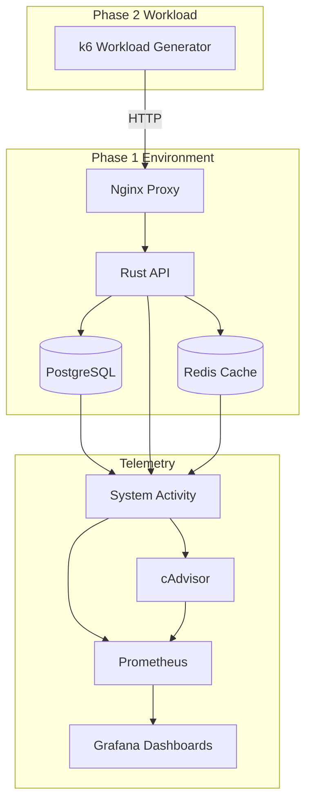

# Phase 2 Design & Architecture

Phase 2 focuses exclusively on generating deterministic workload into the existing Phase 1 application environment.

## Workload Generation Architecture

## Component Design
- **Workload Generation:** Powered by `k6` executing via Docker containers attached directly to the `oscar_sim_net` network.
- **Nginx Entry Point:** Traffic is exclusively routed to `http://nginx:80`, proving proxy routing.
- **API & Database Interaction:** k6 scripts perform a distribution of API calls designed to selectively hit caches (`GET /users/:id`) or explicitly miss them to force database SELECT/INSERT load.
- **Configuration:** Stored in `.json` files, separating workload shape logic from JavaScript execution logic.
- **Orchestration:** Managed by a PowerShell script `run_workload.ps1` that orchestrates Docker, loads configs, and manages experiment metadata.

## Out of Scope
Phase 2 intentionally does **NOT** contain:
- No fault injection (Pumba, etc.)
- No ground truth generation
- No RCA or causal analysis mechanisms
- No OSCAR inference
