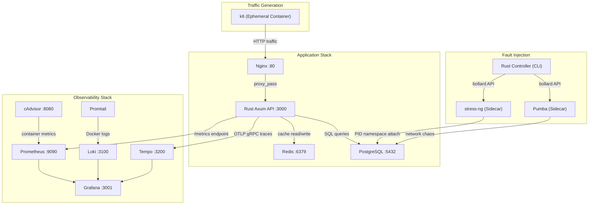
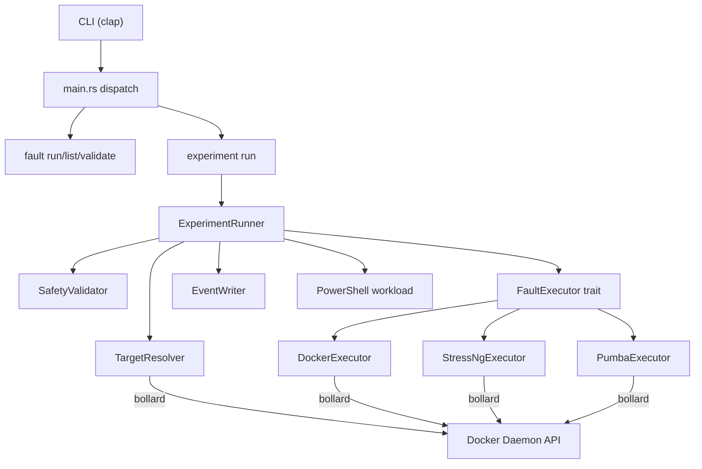

# OSCAR-Sim — Comprehensive End-to-End Technical Report

> **Date:** 2026-08-24  
> **Status:** Phase 3 (Fault Injection) vertical slice validated. Phases 1, 1.5, and 2 complete.  
> **Repository:** `OSCAR_Simulation/`

---

## Table of Contents

1. [What Is OSCAR-Sim?](#1-what-is-oscar-sim)
2. [Core Philosophy](#2-core-philosophy)
3. [High-Level Architecture](#3-high-level-architecture)
4. [Repository Structure (Full File Tree)](#4-repository-structure-full-file-tree)
5. [Environment & Orchestration (Docker Compose)](#5-environment--orchestration-docker-compose)
6. [Application Services (Deep Dive)](#6-application-services-deep-dive)
   - 6.1 [Nginx — Reverse Proxy](#61-nginx--reverse-proxy)
   - 6.2 [Rust API Service (oscar-api)](#62-rust-api-service-oscar-api)
   - 6.3 [PostgreSQL — Primary Database](#63-postgresql--primary-database)
   - 6.4 [Redis — Caching Layer](#64-redis--caching-layer)
7. [Observability Stack (Deep Dive)](#7-observability-stack-deep-dive)
   - 7.1 [Prometheus — Metrics Collection](#71-prometheus--metrics-collection)
   - 7.2 [cAdvisor — Container Infrastructure Metrics](#72-cadvisor--container-infrastructure-metrics)
   - 7.3 [Grafana — Visualization & Dashboards](#73-grafana--visualization--dashboards)
   - 7.4 [Loki — Log Aggregation](#74-loki--log-aggregation)
   - 7.5 [Promtail — Log Shipping Agent](#75-promtail--log-shipping-agent)
   - 7.6 [Tempo — Distributed Tracing](#76-tempo--distributed-tracing)
   - 7.7 [OpenTelemetry — Instrumentation in the API](#77-opentelemetry--instrumentation-in-the-api)
8. [Workload Generation System (Phase 2 — k6)](#8-workload-generation-system-phase-2--k6)
   - 8.1 [Architecture of the Workload System](#81-architecture-of-the-workload-system)
   - 8.2 [Shared Libraries (lib/)](#82-shared-libraries-lib)
   - 8.3 [Workload Profiles (config/)](#83-workload-profiles-config)
   - 8.4 [Scenario Scripts (scenarios/)](#84-scenario-scripts-scenarios)
   - 8.5 [Run Script (scripts/run_workload.ps1)](#85-run-script-scriptsrun_workloadps1)
9. [Fault Injection System (Phase 3 — Rust Controller)](#9-fault-injection-system-phase-3--rust-controller)
   - 9.1 [Why a Custom Rust Controller?](#91-why-a-custom-rust-controller)
   - 9.2 [Controller Architecture](#92-controller-architecture)
   - 9.3 [Rust Dependencies (Cargo.toml)](#93-rust-dependencies-cargotoml)
   - 9.4 [CLI Module (cli.rs)](#94-cli-module-clirs)
   - 9.5 [Data Models (models.rs)](#95-data-models-modelsrs)
   - 9.6 [Target Resolver (targets/resolver.rs)](#96-target-resolver-targetsresolverrs)
   - 9.7 [Fault Executor Trait (faults/executor.rs)](#97-fault-executor-trait-faultsexecutorrs)
   - 9.8 [Docker Executor (faults/docker.rs)](#98-docker-executor-faultsdockerrs)
   - 9.9 [stress-ng Executor (faults/stress_ng.rs)](#99-stress-ng-executor-faultsstress_ngrs)
   - 9.10 [Pumba Executor (faults/pumba.rs)](#910-pumba-executor-faultspumbars)
   - 9.11 [Experiment Runner (experiment/runner.rs)](#911-experiment-runner-experimentrunnerrs)
   - 9.12 [Event Writer / Timeline (events/writer.rs)](#912-event-writer--timeline-eventswriterrs)
   - 9.13 [Safety Validator (safety/limits.rs)](#913-safety-validator-safetylimitsrs)
   - 9.14 [Experiment YAML Definition](#914-experiment-yaml-definition)
10. [Key Architecture Decisions & Bug Fixes](#10-key-architecture-decisions--bug-fixes)
11. [Development Phases & Current Status](#11-development-phases--current-status)
12. [How to Run the Entire System](#12-how-to-run-the-entire-system)
13. [Grafana Dashboards](#13-grafana-dashboards)
14. [Data Flow Diagrams](#14-data-flow-diagrams)
15. [Future Roadmap](#15-future-roadmap)
16. [Plain-English Summary (Explain-to-Anyone)](#16-plain-english-summary-explain-to-anyone)

---

## 1. What Is OSCAR-Sim?

OSCAR-Sim is a **simulation and validation environment** designed for the larger OSCAR project. OSCAR itself is a Root Cause Analysis (RCA) system — it aims to automatically diagnose *why* an infrastructure failure occurred. But to validate whether OSCAR's diagnoses are correct, you need a controlled environment where you can:

1. **Generate realistic telemetry** (metrics, logs, traces) from a real multi-service application.
2. **Inject known failures** (CPU spikes, network delays, container crashes) into specific services.
3. **Record the ground truth** — exactly what was broken, when, and where — so OSCAR's output can be graded for accuracy.

OSCAR-Sim is that environment. It is **not** a synthetic OS or kernel simulator. It runs **real software** in **real Docker containers** producing **real telemetry**, which makes the data indistinguishable from production.

---

## 2. Core Philosophy

> **"Don't build a simulator engine. Use real services, real containers, real telemetry, and controlled fault injection instead."**

Key principles:

| Principle | Meaning |
|---|---|
| **Real Software Only** | No SimPy, CloudSim, OMNeT++, or ns-3. Academic simulators produce synthetic data that is useless for validating production RCA. |
| **Target Immutability** | Target containers (Postgres, Redis, API) are **never modified** to include fault tools. They run stock production images. Faults are injected via external sidecar containers. |
| **Telemetry First** | If you can't see a metric in Grafana, the feature doesn't exist. Observability is validated before any new phase begins. |
| **Simplicity** | Single `docker compose up` starts everything. No Kubernetes, no event buses, no distributed systems unless required. |

---

## 3. High-Level Architecture



**Traffic flow:** `k6` → `Nginx` → `Rust API` → `Redis` (cache) → `PostgreSQL` (database)  
**Telemetry flow:** `API /metrics` → `Prometheus` → `Grafana`; `Docker logs` → `Promtail` → `Loki` → `Grafana`; `OTLP traces` → `Tempo` → `Grafana`  
**Fault flow:** `Rust Controller` → (via Docker API / bollard) → spawns `stress-ng` or `pumba` sidecar containers that attach to target containers' namespaces.

---

## 4. Repository Structure (Full File Tree)

```
OSCAR_Simulation/
├── .env                                   # Environment variables (ports, passwords)
├── .env.example                           # Template for .env
├── .gitignore
├── AGENT_RULES.md                         # 16 critical rules for AI agents working on this repo
├── DECISIONS.md                           # Architecture Decision Records (ADRs)
├── PROGRESS.md                            # Chronological progress log
├── PROJECT_CONTEXT.md                     # High-level project context & scope
├── docker-compose.yml                     # Full stack orchestration (11 services)
│
├── services/
│   ├── api/                               # The core Rust backend
│   │   ├── Cargo.toml                     # Rust dependencies
│   │   ├── Cargo.lock
│   │   ├── Dockerfile                     # Multi-stage Rust build
│   │   ├── migrations/
│   │   │   └── 20260823000000_init_users.sql  # Creates `users` table
│   │   └── src/
│   │       ├── main.rs                    # Entrypoint: router, OTLP init, metrics middleware
│   │       ├── routes.rs                  # HTTP handlers: create_user, get_user, list_users, get_cache
│   │       ├── db.rs                      # PostgreSQL connection pool & query functions
│   │       ├── cache.rs                   # Redis connection pool & cache read/write
│   │       └── metrics/
│   │           ├── mod.rs                 # Module declaration
│   │           └── registry.rs            # All Prometheus metric definitions
│   └── nginx/
│       └── nginx.conf                     # Reverse proxy config → upstream api:3000
│
├── postgres/
│   └── init.sql                           # Placeholder (migrations in Rust API now)
│
├── controller/                            # Phase 3 Fault Injection Controller
│   ├── Cargo.toml
│   ├── Cargo.lock
│   └── src/
│       ├── main.rs                        # CLI entrypoint & command dispatch
│       ├── cli.rs                         # Clap CLI definition (fault/experiment subcommands)
│       ├── models.rs                      # FaultType, Fault, Experiment, ExperimentPhases structs
│       ├── targets/
│       │   ├── mod.rs
│       │   └── resolver.rs                # Maps logical names → Docker container IDs
│       ├── faults/
│       │   ├── mod.rs
│       │   ├── executor.rs                # FaultExecutor trait (start/stop/status)
│       │   ├── docker.rs                  # DockerExecutor (pause/kill via bollard)
│       │   ├── pumba.rs                   # PumbaExecutor (network delay/loss via sidecar)
│       │   └── stress_ng.rs               # StressNgExecutor (CPU/memory/disk via sidecar)
│       ├── experiment/
│       │   ├── mod.rs
│       │   └── runner.rs                  # Full experiment orchestrator (baseline→fault→recovery)
│       ├── events/
│       │   ├── mod.rs
│       │   └── writer.rs                  # JSONL timeline event writer
│       └── safety/
│           ├── mod.rs
│           └── limits.rs                  # Safety validator (max duration, max workers, max load)
│
├── monitoring/
│   ├── prometheus/
│   │   └── prometheus.yml                 # Scrape config: oscar_api, cadvisor, self
│   ├── grafana/
│   │   └── provisioning/
│   │       ├── datasources/
│   │       │   └── prometheus.yml         # Auto-provisions Prometheus, Loki, Tempo datasources
│   │       └── dashboards/
│   │           ├── dashboards.yml         # Dashboard provider config
│   │           ├── oscar-sim-overview.json # Request count, latency, error rate, cache hit rate
│   │           ├── container-overview.json # CPU, memory, network, disk per container
│   │           └── database-overview.json  # Postgres query rate, connections, latency
│   ├── loki/
│   │   └── loki-config.yaml              # Loki server config (filesystem storage, TSDB index)
│   ├── promtail/
│   │   └── promtail-config.yaml          # Docker service discovery → push to Loki
│   └── tempo/
│       └── tempo-config.yaml             # OTLP receiver (gRPC:4317, HTTP:4318), local storage
│
├── workloads/
│   ├── config/                            # JSON traffic profiles
│   │   ├── baseline.json                  # 2 VUs, 5min, health-only
│   │   ├── normal.json                    # 25 VUs, 10min, full API mix
│   │   ├── load.json                      # Ramp 10→100 VUs over 10min
│   │   ├── sustained.json                 # 100 VUs constant for 10min
│   │   ├── spike.json                     # Ramp to 200 VUs, drop back
│   │   └── burst.json                     # Repeating 25→150 VU bursts
│   ├── lib/                               # Shared k6 JavaScript libraries
│   │   ├── client.js                      # HTTP client wrapper with custom metrics
│   │   ├── users.js                       # createUser, listUsers, getUser, getHealth
│   │   ├── cache.js                       # getCache (trigger cache miss telemetry)
│   │   └── checks.js                      # is200, is201, is404, isSuccessful
│   └── scenarios/                         # k6 scenario scripts (one per profile)
│       ├── baseline.js
│       ├── normal.js
│       ├── load.js
│       ├── sustained.js
│       ├── spike.js
│       └── burst.js
│
├── experiments/
│   ├── postgres_cpu.yaml                  # Example: CPU stress on Postgres for 60s
│   └── metadata/                          # Auto-generated experiment run metadata
│
├── scripts/
│   └── run_workload.ps1                   # PowerShell: run k6 in Docker with metadata
│
└── docs/
    ├── OSCAR_SIM_PHASES_REMINDER.md       # Vision and phase definitions
    ├── phase1/                            # Phase 1 design docs, progress, closure
    ├── phase1.5/                          # Loki/OTel design plan
    ├── phase2/                            # Phase 2 design, implementation, verification
    └── phase3/                            # Phase 3 design, engineering log, known issues
```

---

## 5. Environment & Orchestration (Docker Compose)

**File:** [docker-compose.yml](file:///c:/Users/lokes/OneDrive/Documents/GitHub/OSCAR_Simulation/docker-compose.yml)

The entire system is brought up with a single command: `docker compose up -d`. The compose file defines **11 services** on a shared Docker bridge network (`oscar_sim_net`).

### Services Summary

| Service | Image | Internal Port | External Port | Purpose |
|---|---|---|---|---|
| **postgres** | `postgres:16` | 5432 | 5432 | Primary relational database |
| **redis** | `redis:7-alpine` | 6379 | 6379 | In-memory cache |
| **api** | Custom build (`./services/api`) | 3000 | — (internal only) | Rust Axum REST API |
| **nginx** | `nginx:alpine` | 80 | 8080 | Reverse proxy / load balancer |
| **prometheus** | `prom/prometheus:v2.54.0` | 9090 | 9090 | Time-series metrics DB |
| **grafana** | `grafana/grafana:11.1.0` | 3000 | 3001 | Dashboard UI |
| **cadvisor** | `ghcr.io/google/cadvisor:v0.57.0` | 8080 | 8081 | Container infrastructure metrics |
| **loki** | `grafana/loki:2.9.4` | 3100 | 3100 | Log aggregation backend |
| **promtail** | `grafana/promtail:latest` | 9080 | — | Log collection agent |
| **tempo** | `grafana/tempo:2.4.0` | 3200, 4317, 4318 | 3200, 4317, 4318 | Distributed tracing backend |

### Dependency Chain
The compose file enforces a strict startup order via `depends_on` with `condition: service_healthy`:

```
postgres (healthy) → api (healthy) → nginx (healthy)
redis (healthy) ───↗
api (healthy) → prometheus → grafana
loki → promtail
```

### Environment Variables

**File:** [.env](file:///c:/Users/lokes/OneDrive/Documents/GitHub/OSCAR_Simulation/.env)

```
POSTGRES_USER=oscar_admin
POSTGRES_PASSWORD=your_secure_password
POSTGRES_DB=oscar_sim
POSTGRES_PORT=5432
REDIS_PORT=6379
API_PORT=3000
GRAFANA_PASSWORD=admin
```

### Networking
All services communicate over a single Docker bridge network named `oscar_sim_net`. Services reference each other by container name (e.g., the API connects to `postgres:5432` and `redis:6379`).

### Volumes
- `postgres_data` — persists PostgreSQL data across restarts.
- `prometheus_data` — persists Prometheus TSDB across restarts.
- `grafana_data` — persists Grafana configuration across restarts.

---

## 6. Application Services (Deep Dive)

### 6.1 Nginx — Reverse Proxy

**File:** [nginx.conf](file:///c:/Users/lokes/OneDrive/Documents/GitHub/OSCAR_Simulation/services/nginx/nginx.conf)  
**Image:** `nginx:alpine`  
**External Port:** 8080 → internal 80

Nginx acts as the front door. All external traffic (including k6 workloads) enters through Nginx, which proxies everything to the Rust API backend.

**Key configuration:**
- `worker_processes auto;` — auto-scales to available CPU cores.
- `worker_connections 1024;` — maximum concurrent connections per worker.
- `upstream api_backend { server api:3000; }` — defines the API backend using Docker DNS.
- Forwards headers: `X-Real-IP`, `X-Forwarded-For`, `X-Forwarded-Proto`, `X-Request-ID` (Nginx's built-in `$request_id` for request tracing).

**Why Nginx?** It simulates a realistic production deployment where a reverse proxy sits in front of application servers. This is important because network faults (delay, packet loss) between Nginx and the API will produce realistic latency signatures in telemetry.

---

### 6.2 Rust API Service (oscar-api)

**Directory:** [services/api/](file:///c:/Users/lokes/OneDrive/Documents/GitHub/OSCAR_Simulation/services/api)

This is the heart of the application layer. It is a Rust web server built with the **Axum** framework.

#### 6.2.1 Build System — Dockerfile

**File:** [Dockerfile](file:///c:/Users/lokes/OneDrive/Documents/GitHub/OSCAR_Simulation/services/api/Dockerfile)

Uses a **multi-stage Docker build** for efficiency:
1. **Builder stage** (`rust:1.88`): Compiles the Rust binary. Uses a dependency caching trick — copies `Cargo.toml` first, builds a dummy `main.rs` to cache dependency compilation, then swaps in real source code.
2. **Runtime stage** (`debian:bookworm-slim`): Copies only the compiled binary. Installs `curl` for healthcheck probes.

Final image is small (~100MB) with only the binary and minimal OS libraries.

#### 6.2.2 Rust Dependencies

**File:** [Cargo.toml](file:///c:/Users/lokes/OneDrive/Documents/GitHub/OSCAR_Simulation/services/api/Cargo.toml)

| Crate | Version | Purpose |
|---|---|---|
| `axum` | 0.7 | Async web framework (routing, middleware, extractors) |
| `tokio` | 1.0 (full) | Async runtime for Rust (required by Axum) |
| `serde` / `serde_json` | 1.0 | JSON serialization/deserialization of request/response bodies |
| `tracing` | 0.1 | Structured logging framework |
| `tracing-subscriber` | 0.3 | Log output formatting and filtering |
| `prometheus` | 0.13 | Prometheus client library for defining and exposing metrics |
| `once_cell` | 1.19 | Lazy static initialization for global metric registries |
| `sqlx` | 0.8 | Async PostgreSQL driver with compile-time checked queries |
| `redis` | 0.26 | Async Redis client |
| `deadpool-redis` | 0.16 | Connection pooling for Redis |
| `uuid` | 1.10 | UUID v4 generation for user IDs |
| `opentelemetry` | 0.21 | OpenTelemetry API for distributed tracing |
| `opentelemetry_sdk` | 0.21 | OpenTelemetry SDK implementation |
| `opentelemetry-otlp` | 0.14 | OTLP exporter (sends traces to Tempo via gRPC) |
| `tracing-opentelemetry` | 0.22 | Bridges Rust's `tracing` spans into OpenTelemetry traces |

#### 6.2.3 Application Entrypoint — main.rs

**File:** [main.rs](file:///c:/Users/lokes/OneDrive/Documents/GitHub/OSCAR_Simulation/services/api/src/main.rs)

The entrypoint does the following in order:

1. **Initializes tracing** with an `EnvFilter` (respects `RUST_LOG` env var, defaults to `info`).
2. **Configures OpenTelemetry OTLP exporter**: Connects to `http://tempo:4317` via gRPC (Tonic), identifies itself as `service.name: oscar-sim-api`, and installs a batch trace exporter on the Tokio runtime.
3. **Composes the tracing subscriber**: Layers together `fmt` (stdout), `env_filter`, and `opentelemetry` layers.
4. **Registers Prometheus metrics** by forcing lazy initialization of all metric definitions.
5. **Initializes connection pools**: `db::init_pool()` for Postgres (max 20 connections) and `cache::init_pool()` for Redis.
6. **Builds the Axum router** with routes and a custom `track_metrics` middleware layer.
7. **Starts listening** on `0.0.0.0:{API_PORT}`.

**Routes:**

| Method | Path | Handler | Description |
|---|---|---|---|
| GET | `/` | `root()` | Returns `{ service: "oscar-sim-api", status: "running" }` |
| GET | `/health` | `health()` | Returns `{ status: "ok" }` — used by Docker healthchecks |
| GET | `/metrics` | `metrics_handler()` | Prometheus text exposition format |
| GET | `/users` | `list_users()` | Lists all users from Postgres |
| POST | `/users` | `create_user()` | Creates a user (Postgres + Redis cache) |
| GET | `/users/:id` | `get_user()` | Gets user by UUID (Redis cache → Postgres fallback) |
| GET | `/cache` | `get_cache()` | Generates cache telemetry by querying a nil UUID |

**Metrics Middleware — `track_metrics()`:**

Every request (except `/metrics` itself) passes through this Axum middleware, which:
1. Increments `active_requests` gauge.
2. Records the start time.
3. Passes the request to the next handler.
4. On response, decrements `active_requests`, records `http_request_duration_seconds` histogram, and increments `http_requests_total` counter — all labelled by method, path, and status code.
5. Unmatched routes get labelled as `UNMATCHED_ROUTE` to avoid metric cardinality explosion.

#### 6.2.4 Routes — routes.rs

**File:** [routes.rs](file:///c:/Users/lokes/OneDrive/Documents/GitHub/OSCAR_Simulation/services/api/src/routes.rs)

Defines `AppState` (shared Postgres + Redis pool), request DTOs, and handler functions.

- **`create_user`**: Generates a UUID v4, inserts into Postgres, immediately caches in Redis, returns 201.
- **`get_user`**: Cache-aside pattern — checks Redis first, on miss queries Postgres, on hit caches the result for future requests.
- **`list_users`**: Queries all users from Postgres (no cache).
- **`get_cache`**: Queries Redis for a nil UUID to intentionally generate a cache miss — used by k6 to exercise cache metrics.

All handlers are annotated with `#[tracing::instrument]` which automatically creates OpenTelemetry spans.

#### 6.2.5 Database Layer — db.rs

**File:** [db.rs](file:///c:/Users/lokes/OneDrive/Documents/GitHub/OSCAR_Simulation/services/api/src/db.rs)

- **`init_pool()`**: Creates a `PgPool` with max 20 connections via `sqlx::PgPoolOptions`. Runs database migrations from `./migrations` at startup using `sqlx::migrate!()`.
- **`User` struct**: `{ id: UUID, name: String, email: String }` — derives `Serialize`, `Deserialize`, `sqlx::FromRow`.
- **Every query function** instruments Prometheus metrics:
  - Increments `postgres_queries_total{operation, table}`.
  - Records `postgres_query_duration_seconds{operation, table}` histogram.

**Migration:** [20260823000000_init_users.sql](file:///c:/Users/lokes/OneDrive/Documents/GitHub/OSCAR_Simulation/services/api/migrations/20260823000000_init_users.sql) creates the `users` table:
```sql
CREATE TABLE users (
    id UUID PRIMARY KEY,
    name VARCHAR NOT NULL,
    email VARCHAR NOT NULL UNIQUE,
    created_at TIMESTAMP WITH TIME ZONE DEFAULT CURRENT_TIMESTAMP
);
```

#### 6.2.6 Cache Layer — cache.rs

**File:** [cache.rs](file:///c:/Users/lokes/OneDrive/Documents/GitHub/OSCAR_Simulation/services/api/src/cache.rs)

- **`init_pool()`**: Creates a `deadpool-redis` connection pool from the `REDIS_URL` environment variable.
- **`get_cached_user()`**: Looks up `user:{id}` key in Redis. On hit, increments `cache_hits_total`. On miss, increments `cache_misses_total`.
- **`cache_user()`**: Serializes the `User` struct to JSON, stores in Redis with a **60-second TTL** via `SET EX`.

#### 6.2.7 Metrics Registry — registry.rs

**File:** [registry.rs](file:///c:/Users/lokes/OneDrive/Documents/GitHub/OSCAR_Simulation/services/api/src/metrics/registry.rs)

Defines **8 Prometheus metrics** using `once_cell::Lazy` for thread-safe lazy initialization:

| Metric Name | Type | Labels | Description |
|---|---|---|---|
| `http_requests_total` | IntCounterVec | method, path, status | Total HTTP requests |
| `http_request_duration_seconds` | HistogramVec | method, path, status | Request latency distribution |
| `active_requests` | IntGauge | — | Currently in-flight requests |
| `cache_hits_total` | IntCounter | — | Redis cache hits |
| `cache_misses_total` | IntCounter | — | Redis cache misses |
| `postgres_queries_total` | IntCounterVec | operation, table | Total SQL queries |
| `postgres_query_duration_seconds` | HistogramVec | operation, table | SQL query latency |
| `active_connections` | IntGaugeVec | pool | Active connections (postgres, redis) |

`register_custom_metrics()` is called at startup to force all `Lazy` values to initialize, ensuring metrics are registered with the Prometheus registry before any traffic arrives.

---

### 6.3 PostgreSQL — Primary Database

**Image:** `postgres:16`  
**Port:** 5432  
**Data volume:** `postgres_data` (persisted)

Stock PostgreSQL image. The schema is managed by SQLx migrations in the Rust API (not by `init.sql`). The [init.sql](file:///c:/Users/lokes/OneDrive/Documents/GitHub/OSCAR_Simulation/postgres/init.sql) is now a placeholder redirect comment.

**Healthcheck:** `pg_isready -U oscar_admin -d oscar_sim` every 5s.

---

### 6.4 Redis — Caching Layer

**Image:** `redis:7-alpine`  
**Port:** 6379

Stock Redis image. Used as a cache layer with a **cache-aside pattern**: the API checks Redis before hitting Postgres. Cached entries have a 60-second TTL.

**Healthcheck:** `redis-cli ping` every 5s.

---

## 7. Observability Stack (Deep Dive)

The observability stack implements the **three pillars of observability**: Metrics (Prometheus), Logs (Loki), and Traces (Tempo), unified under **Grafana**.

### 7.1 Prometheus — Metrics Collection

**File:** [prometheus.yml](file:///c:/Users/lokes/OneDrive/Documents/GitHub/OSCAR_Simulation/monitoring/prometheus/prometheus.yml)  
**Image:** `prom/prometheus:v2.54.0`  
**Port:** 9090

Prometheus scrapes metrics from 3 targets every **5 seconds**:

| Job | Target | What it scrapes |
|---|---|---|
| `prometheus` | `localhost:9090` | Prometheus's own internal metrics |
| `oscar_api` | `api:3000` | Application metrics from the Rust API's `/metrics` endpoint |
| `cadvisor` | `cadvisor:8080` | Infrastructure metrics for every running Docker container |

**Storage:** TSDB with 1-day retention (`--storage.tsdb.retention.time=1d`).

---

### 7.2 cAdvisor — Container Infrastructure Metrics

**Image:** `ghcr.io/google/cadvisor:v0.57.0`  
**Port:** 8081 (mapped from internal 8080)

cAdvisor (Container Advisor) runs with `privileged: true` and `pid: host` to access host-level cgroup, namespace, and disk information. It exposes per-container metrics:

- `container_cpu_usage_seconds_total` — CPU time consumed
- `container_memory_usage_bytes` — Memory usage
- `container_network_receive_bytes_total` / `container_network_transmit_bytes_total` — Network I/O
- `container_fs_usage_bytes` — Filesystem usage

**Configuration:** `--docker_only=true` (only monitor Docker containers), `--housekeeping_interval=5s` (refresh every 5 seconds).

**Volume mounts:** Deep read-only host mounts (`/`, `/var/run`, `/sys`, `/var/lib/docker/`, `/dev/disk/`, Docker socket) are required for cAdvisor to introspect container internals.

---

### 7.3 Grafana — Visualization & Dashboards

**Image:** `grafana/grafana:11.1.0`  
**Port:** 3001 (mapped from internal 3000)  
**Login:** `admin` / `admin`

#### Auto-Provisioned Datasources

**File:** [prometheus.yml (datasources)](file:///c:/Users/lokes/OneDrive/Documents/GitHub/OSCAR_Simulation/monitoring/grafana/provisioning/datasources/prometheus.yml)

Three datasources are provisioned at startup via YAML — no manual UI configuration needed:

| Datasource | UID | URL | Default? |
|---|---|---|---|
| Prometheus | `prometheus` | `http://prometheus:9090` | ✅ Yes |
| Loki | `loki` | `http://loki:3100` | No |
| Tempo | `tempo` | `http://tempo:3200` | No |

#### Auto-Provisioned Dashboards

**File:** [dashboards.yml](file:///c:/Users/lokes/OneDrive/Documents/GitHub/OSCAR_Simulation/monitoring/grafana/provisioning/dashboards/dashboards.yml)

All dashboard JSON files in the provisioning directory are auto-loaded into a `OSCAR-Sim` folder in Grafana, refreshed every 10 seconds.

**Three dashboards are provided:**

1. **OSCAR-Sim Overview** ([oscar-sim-overview.json](file:///c:/Users/lokes/OneDrive/Documents/GitHub/OSCAR_Simulation/monitoring/grafana/provisioning/dashboards/oscar-sim-overview.json)):
   - Total Requests (`sum(http_requests_total)`)
   - Active Requests (`sum(active_requests)`)
   - Request Rate 1m (`sum(rate(http_requests_total[1m]))`)
   - Average Request Latency 1m
   - Error Rate (4xx/5xx) 1m
   - Cache Hit Rate 1m (as percentage)

2. **Container Overview** ([container-overview.json](file:///c:/Users/lokes/OneDrive/Documents/GitHub/OSCAR_Simulation/monitoring/grafana/provisioning/dashboards/container-overview.json)):
   - CPU Usage by Service (from cAdvisor)
   - Memory Usage by Service
   - Network Receive Rate
   - Network Transmit Rate
   - Filesystem Usage

3. **Database Overview** ([database-overview.json](file:///c:/Users/lokes/OneDrive/Documents/GitHub/OSCAR_Simulation/monitoring/grafana/provisioning/dashboards/database-overview.json)):
   - PostgreSQL Query Rate per second (`rate(postgres_queries_total[1m])`)
   - PostgreSQL Active Connections (`active_connections{pool="postgres"}`)
   - PostgreSQL Query Latency (average per operation)

---

### 7.4 Loki — Log Aggregation

**File:** [loki-config.yaml](file:///c:/Users/lokes/OneDrive/Documents/GitHub/OSCAR_Simulation/monitoring/loki/loki-config.yaml)  
**Image:** `grafana/loki:2.9.4`  
**Port:** 3100

Loki is a log aggregation system from Grafana Labs. It indexes logs by **labels** (not full-text) for efficiency.

**Configuration details:**
- `auth_enabled: false` — single-tenant mode (no authentication required).
- **Storage:** Local filesystem (`/loki/chunks` for data, `/loki/rules` for alerting rules).
- **Schema:** TSDB store with filesystem object store, `v13` schema, indexes rotated every 24h.
- **Replication:** Single instance (`replication_factor: 1`) — appropriate for local dev.

---

### 7.5 Promtail — Log Shipping Agent

**File:** [promtail-config.yaml](file:///c:/Users/lokes/OneDrive/Documents/GitHub/OSCAR_Simulation/monitoring/promtail/promtail-config.yaml)  
**Image:** `grafana/promtail:latest`

Promtail is Loki's log collection agent. It discovers Docker containers via the Docker socket and ships their logs to Loki.

**How it works:**
1. **Docker Service Discovery** (`docker_sd_configs`): Connects to the Docker socket (`unix:///var/run/docker.sock`) and discovers all running containers every 5 seconds.
2. **Relabel Rules**: Extracts two labels:
   - `container` — the Docker container name (regex strips the leading `/`).
   - `compose_service` — the Docker Compose service name (from label `com.docker.compose.service`).
3. **Push endpoint:** `http://loki:3100/loki/api/v1/push`.
4. **Positions file:** `/tmp/positions.yaml` — tracks read progress so logs aren't re-sent on restart.

**Volume mounts:** Docker container log directory (`/var/lib/docker/containers`) and Docker socket for service discovery.

---

### 7.6 Tempo — Distributed Tracing

**File:** [tempo-config.yaml](file:///c:/Users/lokes/OneDrive/Documents/GitHub/OSCAR_Simulation/monitoring/tempo/tempo-config.yaml)  
**Image:** `grafana/tempo:2.4.0`  
**Ports:** 3200 (Tempo API), 4317 (OTLP gRPC), 4318 (OTLP HTTP)

Tempo is Grafana's distributed tracing backend (comparable to Jaeger or Zipkin).

**Configuration details:**
- **Receivers:** Accepts traces via OpenTelemetry Protocol (OTLP) over both gRPC (`:4317`) and HTTP (`:4318`).
- **Ingester:** `max_block_duration: 5m` — flushes trace blocks every 5 minutes.
- **Compactor:** `block_retention: 24h` — retains trace data for 24 hours.
- **Storage:** Local filesystem (`/tmp/tempo/blocks` for completed blocks, `/tmp/tempo/wal` for write-ahead log).

---

### 7.7 OpenTelemetry — Instrumentation in the API

OpenTelemetry is not a standalone service but a set of libraries integrated directly into the Rust API:

1. **`opentelemetry` + `opentelemetry_sdk`**: Core API and SDK for creating traces.
2. **`opentelemetry-otlp`**: Exports traces via gRPC to `http://tempo:4317`.
3. **`tracing-opentelemetry`**: Bridges Rust's `tracing` crate spans into OpenTelemetry trace spans. This means every `#[tracing::instrument]` annotation on a handler function automatically creates a distributed trace span.

The tracer is configured with `service.name: "oscar-sim-api"` and uses batch export on the Tokio runtime.

---

## 8. Workload Generation System (Phase 2 — k6)

**Directory:** [workloads/](file:///c:/Users/lokes/OneDrive/Documents/GitHub/OSCAR_Simulation/workloads)

[k6](https://k6.io/) (by Grafana Labs) is a modern load testing tool written in Go. It executes JavaScript scenario scripts that define virtual user behavior.

### 8.1 Architecture of the Workload System

```
workloads/
├── config/         # JSON files defining VU counts, durations, and request distribution
├── lib/            # Shared JavaScript modules (HTTP client, API wrappers, checks)
└── scenarios/      # One scenario script per workload profile (imports config + lib)
```

The design separates **what to test** (config) from **how to test** (lib) from **the test plan** (scenarios).

### 8.2 Shared Libraries (lib/)

#### client.js — HTTP Client Wrapper

**File:** [client.js](file:///c:/Users/lokes/OneDrive/Documents/GitHub/OSCAR_Simulation/workloads/lib/client.js)

Central HTTP client that all scenario scripts use:
- `BASE_URL` defaults to `http://localhost:8080` but is overridden to `http://nginx:80` when running inside Docker via the `TARGET_URL` environment variable.
- Injects `Content-Type: application/json` and `Accept: application/json` headers on every request.
- Records **custom k6 metrics**: `custom_req_duration` (Trend) and `custom_req_errors` (Counter). Errors are counted for any status ≥ 400 except 404 (which are intentional).

#### users.js — API Interaction Library

**File:** [users.js](file:///c:/Users/lokes/OneDrive/Documents/GitHub/OSCAR_Simulation/workloads/lib/users.js)

Wraps the API endpoints into reusable functions:
- `createUser()` — POST `/users` with random name/email.
- `listUsers()` — GET `/users`.
- `getUser(id)` — GET `/users/{id}`.
- `getHealth()` — GET `/health`.
- `generateRandomId()` — Creates a random UUID v4 string (for intentional cache misses / 404s).

#### cache.js — Cache Telemetry Generator

**File:** [cache.js](file:///c:/Users/lokes/OneDrive/Documents/GitHub/OSCAR_Simulation/workloads/lib/cache.js)

`getCache()` hits the `/cache` endpoint, which queries Redis for a nil UUID — guaranteed to be a cache miss. This exercises the `cache_misses_total` metric.

#### checks.js — Assertion Helpers

**File:** [checks.js](file:///c:/Users/lokes/OneDrive/Documents/GitHub/OSCAR_Simulation/workloads/lib/checks.js)

Simple status code checkers: `is200()`, `is201()`, `is404()`, `isSuccessful()`. Used with k6's `check()` function for pass/fail reporting.

### 8.3 Workload Profiles (config/)

Each JSON config file defines the shape of the workload:

| Profile | Type | VUs | Duration | Shape |
|---|---|---|---|---|
| **baseline** | Constant | 2 | 5m | Health checks only (90% health, 10% listUsers) |
| **normal** | Constant | 25 | 10m | Full API mix (all endpoints exercised) |
| **load** | Ramping stages | 10→25→50→100 | 10m | Progressive ramp-up to simulate growing traffic |
| **sustained** | Ramping stages | →100→100→10 | 12m | 100 VUs sustained for 10 minutes |
| **spike** | Ramping stages | 10→200→200→10 | 4.5m | Sudden spike to 200 VUs, then drop |
| **burst** | Ramping stages | 25→150→25→150→25→150→25 | 4m | Repeating bursts to 150 VUs |

**Request Distribution** (for non-baseline profiles):

| Endpoint | Probability |
|---|---|
| Health check | 5% |
| List users | 30% |
| Create user | 10% |
| Get user (cache hit) | 15% |
| Get user (cache miss / 404) | 15% |
| Cache miss | 20% |
| Invalid request (error) | 5% |

### 8.4 Scenario Scripts (scenarios/)

Each scenario script:
1. Imports shared libraries from `lib/`.
2. Reads its config JSON from `config/`.
3. Sets k6 options (`vus`, `duration`, or `stages` depending on type).
4. In the default function (executed per iteration per VU), generates a random number 0-100 and uses cumulative probability to select which endpoint to hit.

### 8.5 Run Script (scripts/run_workload.ps1)

**File:** [run_workload.ps1](file:///c:/Users/lokes/OneDrive/Documents/GitHub/OSCAR_Simulation/scripts/run_workload.ps1)

PowerShell wrapper that:
1. Validates the workload name against allowed values.
2. Generates an experiment ID with timestamp (`exp-20260824-090944`).
3. Creates a metadata JSON file in `experiments/metadata/`.
4. Runs k6 in an ephemeral Docker container:
   ```
   docker run --rm -i --network oscar_simulation_oscar_sim_net \
     -e TARGET_URL=http://nginx:80 \
     -v ./workloads:/workloads \
     grafana/k6 run /workloads/scenarios/{name}.js
   ```
5. Updates metadata with end time and `"completed"` status.

---

## 9. Fault Injection System (Phase 3 — Rust Controller)

**Directory:** [controller/](file:///c:/Users/lokes/OneDrive/Documents/GitHub/OSCAR_Simulation/controller)

### 9.1 Why a Custom Rust Controller?

Instead of using bash scripts to orchestrate faults, a custom Rust controller was built because:
- **Type safety**: Experiment definitions, fault types, and parameters are strongly typed (serde YAML/JSON), preventing runtime misconfigurations.
- **Exact timestamping**: The controller logs every event with RFC 3339 timestamps to a JSONL timeline — critical for later correlating with telemetry.
- **Orchestration**: Coordinates the workload script (Phase 2) and fault executor (Phase 3) simultaneously, enforcing the Baseline → Fault → Recovery timeline.
- **Docker API via bollard**: Communicates directly with the Docker daemon over HTTP, avoiding Windows console deadlocks (see Section 10).

### 9.2 Controller Architecture



### 9.3 Rust Dependencies (Cargo.toml)

**File:** [Cargo.toml](file:///c:/Users/lokes/OneDrive/Documents/GitHub/OSCAR_Simulation/controller/Cargo.toml)

| Crate | Version | Purpose |
|---|---|---|
| `anyhow` | 1.0 | Ergonomic error handling with context |
| `async-trait` | 0.1 | Allows async methods in traits (for `FaultExecutor`) |
| `bollard` | 0.21 | Docker Engine API client (HTTP over named pipe on Windows) |
| `clap` | 4.6 (derive) | Command-line argument parsing with derive macros |
| `serde` / `serde_json` | 1.0 | JSON serialization for event logging |
| `serde_yaml` | 0.9 | YAML parsing for experiment definitions |
| `thiserror` | 2.0 | Derive macro for custom error types |
| `tokio` | 1.53 (full) | Async runtime |
| `tracing` / `tracing-subscriber` | 0.1 / 0.3 | Structured logging |
| `chrono` | 0.4 | UTC timestamps for experiment IDs and event logging |

### 9.4 CLI Module (cli.rs)

**File:** [cli.rs](file:///c:/Users/lokes/OneDrive/Documents/GitHub/OSCAR_Simulation/controller/src/cli.rs)

Uses `clap` derive macros to define a two-level subcommand structure:

```
oscar-sim
├── fault
│   ├── list                              # Print available fault types
│   ├── validate --fault-type X --target Y # Resolve target, verify feasibility
│   └── run --fault-type X --target Y --duration Zs  # Execute a single fault
└── experiment
    └── run <path>                         # Execute a full YAML experiment
```

### 9.5 Data Models (models.rs)

**File:** [models.rs](file:///c:/Users/lokes/OneDrive/Documents/GitHub/OSCAR_Simulation/controller/src/models.rs)

**`FaultType` enum** — 7 supported fault types:

| Variant | Serde name | Executor |
|---|---|---|
| `CpuStress` | `cpu_stress` | stress-ng |
| `MemorySpike` | `memory_spike` | stress-ng |
| `DiskIo` | `disk_io` | stress-ng |
| `NetworkDelay` | `network_delay` | Pumba |
| `PacketLoss` | `packet_loss` | Pumba |
| `ContainerPause` | `container_pause` | Docker |
| `ContainerKill` | `container_kill` | Docker |

**`FaultParameters` struct**: Optional config fields — `workers` (number of stress workers), `load` (CPU load %), `delay_ms` (network delay), `loss_percent` (packet loss %).

**`Experiment` struct**: Wraps the experiment name, workload profile, phase durations (baseline/fault/recovery), and fault definition.

### 9.6 Target Resolver (targets/resolver.rs)

**File:** [resolver.rs](file:///c:/Users/lokes/OneDrive/Documents/GitHub/OSCAR_Simulation/controller/src/targets/resolver.rs)

Maps logical service names (e.g., `"postgres"`, `"api"`) to actual Docker container IDs.

**Resolution strategy:**
1. Queries the Docker API (via `bollard`) for containers with label `com.docker.compose.service={logical_name}`.
2. If no results, falls back to searching all containers by name substring match.
3. Returns the full container ID string.

This is essential because Docker container IDs change on every `docker compose up`. The controller never hardcodes container IDs.

### 9.7 Fault Executor Trait (faults/executor.rs)

**File:** [executor.rs](file:///c:/Users/lokes/OneDrive/Documents/GitHub/OSCAR_Simulation/controller/src/faults/executor.rs)

```rust
#[async_trait]
pub trait FaultExecutor {
    async fn start(&self) -> Result<()>;    // Inject the fault
    async fn stop(&self) -> Result<()>;     // Remove the fault and recover
    async fn status(&self) -> Result<String>; // Check if fault is active
}
```

Three concrete implementations: `DockerExecutor`, `StressNgExecutor`, `PumbaExecutor`.

### 9.8 Docker Executor (faults/docker.rs)

**File:** [docker.rs](file:///c:/Users/lokes/OneDrive/Documents/GitHub/OSCAR_Simulation/controller/src/faults/docker.rs)

Handles **container lifecycle faults** using native Docker API calls via `bollard`:

| Fault | start() | stop() |
|---|---|---|
| `ContainerPause` | `docker.pause_container()` | `docker.unpause_container()` |
| `ContainerKill` | `docker.kill_container()` | `docker.start_container()` |

**`status()`** inspects the container state and returns `"Paused"`, `"Running"`, `"Dead"`, or the raw status.

### 9.9 stress-ng Executor (faults/stress_ng.rs)

**File:** [stress_ng.rs](file:///c:/Users/lokes/OneDrive/Documents/GitHub/OSCAR_Simulation/controller/src/faults/stress_ng.rs)

Injects **resource exhaustion faults** (CPU, memory, disk I/O) by spawning an ephemeral `polinux/stress-ng` container that shares the target container's **PID namespace** (`pid_mode: container:{id}`).

**How it works:**
1. `start()`: Creates a container named `stress_{first_12_chars_of_target_id}` with:
   - Image: `polinux/stress-ng`
   - PID namespace: attached to the target container (so stress-ng processes appear inside the target's process space)
   - Command: e.g., `--cpu 4 --cpu-load 80 --timeout 600s`
   - Safety timeout: 600s auto-kill even if controller fails
2. Before creating, attempts to force-remove any leftover container from a previous run.
3. `stop()`: Force-removes the stress container.

**Fault-specific commands:**
| Fault | Command |
|---|---|
| `CpuStress` | `--cpu {workers} --cpu-load {load}` |
| `MemorySpike` | `--vm {workers} --vm-bytes 256M` |
| `DiskIo` | `--hdd {workers}` |

**Default parameters:** 2 workers, 80% load.

### 9.10 Pumba Executor (faults/pumba.rs)

**File:** [pumba.rs](file:///c:/Users/lokes/OneDrive/Documents/GitHub/OSCAR_Simulation/controller/src/faults/pumba.rs)

Injects **network chaos faults** using the [Pumba](https://github.com/alexei-led/pumba) tool. Spawns an ephemeral `gaiaadm/pumba` container.

**How it works:**
1. `start()`: Creates a container named `pumba_{first_12_chars_of_target_id}` with:
   - Image: `gaiaadm/pumba`
   - Volume: Docker socket mounted for Pumba to control other containers
   - Command: `netem --duration 10m delay --time {ms}` or `netem --duration 10m loss --percent {pct}`
   - Target: The target container ID is passed as the last argument
2. `stop()`: Force-removes the Pumba container.

**Fault-specific commands:**
| Fault | Command suffix |
|---|---|
| `NetworkDelay` | `delay --time {delay_ms}` (default: 100ms) |
| `PacketLoss` | `loss --percent {loss_percent}` (default: 10%) |

### 9.11 Experiment Runner (experiment/runner.rs)

**File:** [runner.rs](file:///c:/Users/lokes/OneDrive/Documents/GitHub/OSCAR_Simulation/controller/src/experiment/runner.rs)

The **orchestrator** that ties everything together. Given an `Experiment` struct (parsed from YAML), it executes the full experiment lifecycle:

```
1. Safety Validation    → SafetyValidator::validate()
2. Start Workload       → powershell.exe -File run_workload.ps1
3. BASELINE phase       → sleep(baseline_duration)
4. Resolve Target       → TargetResolver::resolve()
5. Start Fault          → FaultExecutor::start()
6. FAULT phase          → sleep(fault_duration)
7. Stop Fault           → FaultExecutor::stop()
8. RECOVERY phase       → sleep(recovery_duration)
9. Kill Workload        → workload_process.kill()
```

**Every step is logged** to a JSONL timeline file via the `EventWriter`.

The workload is spawned as a background PowerShell process so it runs concurrently during all three phases. After recovery, the workload process is killed.

### 9.12 Event Writer / Timeline (events/writer.rs)

**File:** [writer.rs](file:///c:/Users/lokes/OneDrive/Documents/GitHub/OSCAR_Simulation/controller/src/events/writer.rs)

Writes structured events to a `timeline.jsonl` file inside `experiments/metadata/EXP-{name}-{timestamp}/`.

**Event types** (tagged union via `serde`):
- `experiment_started`
- `workload_started`
- `baseline_started`
- `fault_requested`
- `fault_started`
- `fault_stopped`
- `recovery_started`
- `experiment_completed`

Each event carries an `experiment_id`, a `timestamp` (RFC 3339), and additional context (fault_id, fault_type, target, profile).

**Example timeline.jsonl:**
```jsonl
{"event_type":"experiment_started","experiment_id":"EXP-1692883200","timestamp":"2026-08-24T09:00:00+00:00"}
{"event_type":"workload_started","experiment_id":"EXP-1692883200","profile":"baseline","timestamp":"2026-08-24T09:00:00+00:00"}
{"event_type":"baseline_started","experiment_id":"EXP-1692883200","timestamp":"2026-08-24T09:00:01+00:00"}
{"event_type":"fault_requested","experiment_id":"EXP-1692883200","fault_id":"FAULT-1692883261","fault_type":"CpuStress","target":"postgres","timestamp":"2026-08-24T09:01:01+00:00"}
{"event_type":"fault_started","experiment_id":"EXP-1692883200","fault_id":"FAULT-1692883261","fault_type":"CpuStress","target":"postgres","timestamp":"2026-08-24T09:01:01+00:00"}
{"event_type":"fault_stopped","experiment_id":"EXP-1692883200","fault_id":"FAULT-1692883261","timestamp":"2026-08-24T09:02:01+00:00"}
{"event_type":"recovery_started","experiment_id":"EXP-1692883200","timestamp":"2026-08-24T09:02:01+00:00"}
{"event_type":"experiment_completed","experiment_id":"EXP-1692883200","timestamp":"2026-08-24T09:03:01+00:00"}
```

### 9.13 Safety Validator (safety/limits.rs)

**File:** [limits.rs](file:///c:/Users/lokes/OneDrive/Documents/GitHub/OSCAR_Simulation/controller/src/safety/limits.rs)

Pre-flight validation before any fault is injected:

| Rule | Limit |
|---|---|
| Max fault duration | 600 seconds (10 minutes) |
| Max CPU workers | 8 |
| Max CPU load | 100% |

If any safety check fails, the experiment is aborted with a clear error message **before** any containers are touched.

### 9.14 Experiment YAML Definition

**File:** [postgres_cpu.yaml](file:///c:/Users/lokes/OneDrive/Documents/GitHub/OSCAR_Simulation/experiments/postgres_cpu.yaml)

```yaml
name: postgres_cpu_stress_001

workload:
  profile: baseline

phases:
  baseline: 60s
  fault: 60s
  recovery: 60s

fault:
  type: cpu_stress
  target: postgres
  parameters:
    workers: 4
    load: 80
```

This defines: run the `baseline` k6 workload, observe for 60s, then inject a CPU stress fault (4 workers at 80% load) into the Postgres container for 60s, then observe recovery for 60s.

---

## 10. Key Architecture Decisions & Bug Fixes

### ADR 1: Rust Controller over Bash Scripts
Bash scripts are fragile for orchestrating concurrent Docker operations, timing, and structured event logging. A typed Rust application with `bollard` provides reliability and exact timestamps.

### ADR 2: Sidecar Containers for Fault Injection
Modifying target images (e.g., installing stress-ng inside the Postgres image) violates the requirement that targets remain **realistic production images**. Instead, ephemeral sidecar containers share PID/Network/Cgroup namespaces with the target.

### ADR 3: bollard over std::process::Command (Critical Bug Fix)

> [!WARNING]
> **Root Cause:** On Windows, running `docker.exe` via `std::process::Command` from Tokio while a concurrent PowerShell process (running k6) was printing heavily caused the **Windows Console subsystem to deadlock**. `docker.exe` could not acquire a console handle and hung indefinitely.

**Solution:** The controller uses `bollard` to speak directly to the Docker Daemon via HTTP over the Windows named pipe (`//./pipe/docker_engine`), completely bypassing `docker.exe` and the OS console. This eliminated the ~4-minute deadlock.

**Validation:** After the fix, the CPU stress fault container starts within **~269ms** of being requested, overlapping perfectly with the workload.

---

## 11. Development Phases & Current Status

| Phase | Name | Status | What was delivered |
|---|---|---|---|
| **Phase 1** | Environment + Observability | ✅ Complete | All 7 core services running, Grafana showing metrics |
| **Phase 1.5** | Extended Observability | ✅ Complete | Loki, Promtail, Tempo, OpenTelemetry integrated |
| **Phase 2** | Workload Generation | ✅ Complete / Frozen | 6 k6 workload profiles, shared libraries, run script |
| **Phase 3** | Fault Injection | 🚧 Vertical Slice Done | Rust controller, 3 executors, experiment runner, first experiment validated |
| **Phase 4** | Ground Truth Engine | ⬜ Not Started | Will store expected causal chains for RCA validation |
| **Phase 5** | Scenario Library | ⬜ Not Started | Library of fault scenarios with UI buttons |
| **Phase 6** | OSCAR Integration | ⬜ Not Started | Feed telemetry + ground truth into OSCAR RCA |

---

## 12. How to Run the Entire System

### Step 1: Start the Environment
```bash
docker compose up -d
```
This starts all 11 services. Wait for all healthchecks to pass (`docker ps` should show all containers as `healthy`).

### Step 2: Open Grafana
Navigate to **http://localhost:3001** in your browser. Login: `admin` / `admin`.

### Step 3: Run a Workload
```powershell
# Single workload
.\scripts\run_workload.ps1 -WorkloadName "baseline"

# All workloads sequentially
foreach ($w in @("baseline","normal","load","sustained","spike","burst")) {
    .\scripts\run_workload.ps1 -WorkloadName $w
}
```

### Step 4: Run a Fault Injection Experiment
```powershell
cd controller
cargo run -- experiment run experiments/postgres_cpu.yaml
```

### Step 5: View Results
- **Grafana dashboards** show real-time metrics, logs, and traces.
- **Experiment metadata** is written to `experiments/metadata/EXP-*/timeline.jsonl`.

---

## 13. Grafana Dashboards

| Dashboard | What it shows | Key PromQL queries |
|---|---|---|
| **OSCAR-Sim Overview** | Application-level request health | `sum(rate(http_requests_total[1m]))`, `rate(http_request_duration_seconds_sum[1m]) / rate(http_request_duration_seconds_count[1m])` |
| **Container Overview** | Per-container CPU, memory, network, disk | `sum(rate(container_cpu_usage_seconds_total[1m])) by (service)` |
| **Database Overview** | Postgres query throughput, latency, connections | `rate(postgres_queries_total[1m])`, `active_connections{pool="postgres"}` |

---

## 14. Data Flow Diagrams

### Request Data Flow
```
k6 VU → HTTP GET/POST → Nginx:80 → proxy_pass → API:3000
  → route handler
    → Redis cache lookup (hit → return)
    → Postgres query (miss → cache result → return)
  → Axum middleware records metrics
  → tracing creates OTel span → batch export to Tempo:4317
  → Prometheus scrapes API:3000/metrics every 5s
  → Grafana queries Prometheus
```

### Log Data Flow
```
Container stdout/stderr → Docker log driver → /var/lib/docker/containers/
  → Promtail discovers via Docker socket
  → Promtail pushes to Loki:3100/loki/api/v1/push
  → Grafana queries Loki
```

### Fault Injection Data Flow
```
Experiment YAML → Controller parses → SafetyValidator checks
  → Controller spawns workload (PowerShell → k6 Docker container)
  → Controller sleeps (baseline)
  → Controller resolves target → bollard → Docker API → container ID
  → Controller creates stress-ng/pumba sidecar → bollard → Docker API
    → Sidecar attaches to target's PID/network namespace
    → Target container experiences CPU spike / network delay / etc.
  → Controller sleeps (fault duration)
  → Controller removes sidecar → bollard → Docker API
  → Controller sleeps (recovery)
  → Controller kills workload
  → EventWriter logs timeline to JSONL
```

---

## 15. Future Roadmap

### Phase 4: Ground Truth Engine
Store the expected outcome of each experiment: "If I inject CPU stress into Postgres, the expected causal chain is: `cpu_pressure → query_latency↑ → api_latency↑ → error_rate↑`." This becomes the answer key for grading OSCAR's RCA output.

### Phase 5: Scenario Library
Build a library of pre-defined fault scenarios covering the 10 core failure modes (CPU hog, memory leak, memory spike, disk I/O, disk pressure, network latency, packet loss, container crash, container pause, cascading dependency failure).

### Phase 6: OSCAR Integration
Connect OSCAR to consume telemetry from the simulation environment, run its RCA algorithms, and have its output graded against the Phase 4 ground truth.

---

## 16. Plain-English Summary (Explain-to-Anyone)

> **"Imagine you have a small web application: a website, a database, and a cache, all running inside Docker containers on your laptop. We built a system that:**
>
> 1. **Monitors everything** — we can see CPU usage, memory, network traffic, every database query, every HTTP request, and every log line in real-time on a Grafana dashboard.
>
> 2. **Generates fake traffic** — we use a tool called k6 that simulates hundreds of users hitting the website simultaneously, from gentle browsing to massive traffic spikes.
>
> 3. **Breaks things on purpose** — we built a custom Rust program that can spike the database's CPU to 80%, add 100ms of network delay, crash a container, or flood the disk. It does this by spinning up temporary Docker containers that attach to the target and stress it out.
>
> 4. **Records exactly what happened** — every fault has a precise timestamp log so we know the exact second the CPU spike started and stopped.
>
> **Why?** Because we're building an AI system (OSCAR) that diagnoses infrastructure failures. To test whether OSCAR's diagnoses are correct, we need a lab where we know exactly what broke, when, and where. OSCAR-Sim is that lab."
